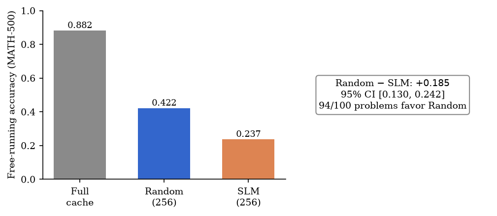
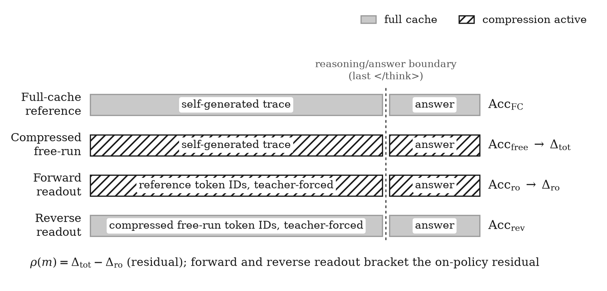

<div align="center">

# The Trajectory Audit

### *Near-Lossless Under Readout, Collapse Under Free Generation:<br>A Trajectory Audit of KV-Cache Compression for Reasoning*

**Muhammad Ali Shah** · LUMS

   

</div>

---

> **The same compression method can be certified near-lossless and be collapsing in deployment — at the same time, honestly, on the same benchmark.** It depends on whether the evaluation lets the model write its own reasoning. This repo measures that gap, explains its mechanism, and ships the protocol for auditing it.

KV-cache eviction methods are certified *near-lossless* almost entirely on evidence that holds the generated text fixed (perplexity, teacher-forced accuracy, retrieval probes). Free-running reasoning benchmarks report severe degradation for the same methods. **Both are right — they measure different channels of the same loss.**

## The result in one figure

<p align="center"></p>

On MATH-500 with DeepSeek-R1-Distill-Qwen-7B at cache budget 256 (3.8% of the mean trace), a protocol that teacher-forces the reference reasoning trace and scores answer readout would certify **Random eviction at 0.765** — while its deployed, free-running accuracy is **0.422**. The difference is a **trajectory residual**: accuracy loss that held-trace evaluation *structurally cannot see*, because divergence is exactly zero at the moment of eviction and compounds over the trajectory that follows.

| Policy @256 | Free-run | Readout | Trajectory residual | Bracket (excl. 0) |
|---|---:|---:|---:|---:|
| Random | 0.422 | 0.765 | **−0.343** | [−0.343, −0.246] |
| StreamingLLM | 0.237 | 0.584 | **−0.347** | [−0.466, −0.347] |
| H2O-style | 0.247 | 0.597 | **−0.349** | [−0.463, −0.349] |
| R-KV (certified port) | 0.520 | 0.798 | **−0.278** | [−0.278, −0.221] |

*Full-cache reference 0.882. A residual of similar magnitude exists for every policy tested — including the best free-runner. All brackets and problem-clustered 95% CIs exclude zero, under every treatment of ambiguous rows.*

## The trajectory audit (the deliverable)

A four-step, intervention-agnostic protocol for pricing what held-trace evaluation misses — applicable to cache quantization, speculative decoding, early exit, retrieval truncation, or any intervention applied *during* generation:

<p align="center"></p>

1. **Forward readout** — hold a reference trace fixed; measure the intervention's effect on answer readout.
2. **Free-run** — let the intervention shape the whole trajectory; measure the total effect.
3. **Reverse readout** — read the intervention's own traces out *without* it; forward + reverse bracket the trajectory share of the cost.
4. **Divergence profile** — check per-step divergence for compounding after the intervention's onset.

The audit ships with its **validity kit**, and every instrument certifies itself before any number is read:

| Control | What it proves | Result here |
|---|---|---:|
| Two-reference negative control | the distribution instrument doesn't false-positive | floor 0.068, 0% significant |
| Pre-intervention self-check | the replay harness adds zero divergence of its own | TV = 0.0000 exactly |
| Resampling calibration | answer-regeneration easiness can't manufacture the effect | +0.023 (≥12× below residuals) |
| Exact replication | generation is deterministic under the pinned seeds | 800/800 rows identical |

## Why you can trust these numbers

This project is run under an unusually strict evidence discipline:

- **Preregistered protocol** with append-only, dated amendments — including a pre-committed confirm/complicate/refute read that came out **COMPLICATE** and is reported as such.
- **Two-stage integrity gate** for the R-KV port: retained-set parity vs the authors' code (Jaccard 1.0), then a real-generation smoke — which caught a real bug the synthetic harness could not see.
- Truncated generations stay in every denominator, scored incorrect. Result rows are never patched — buggy-instrument data is regenerated wholesale.
- Every displayed number is the mechanical `%.3f` rendering of its archived artifact; exact token-ID sidecars enable bitwise-faithful replay.
- Boundaries are self-reported: the random-beats-recency ordering **reverses on the Llama base** (attention-sink sensitivity), and the paper says so in its own threats section.

## Repository map

```
src/kvcache/        all computation & scientific logic (presses, replay, grading, stats)
scripts/            thin orchestration: runners, nightly queue, harvester, figures
configs/            pinned models/datasets + one YAML per experiment + the run queue
tests/              CPU-only, no network, no weights — 135 tests
figures/            the paper's figures (generated by scripts/make_paper_figures.py)
docs/               workflow, figure method, API probes, R-KV port notes
PREREGISTRATION.md  frozen protocol + amendment log        PAPER_FINDINGS.md  results record
kv_readout_vs_trajectory_paper.tex                         the paper
```

## Quickstart (local)

```bash
python -m venv .venv && .venv/bin/pip install -e .[dev]
make lint     # ruff + black
make test     # pytest, CPU-only, <5s
make dryrun   # validates every runner × config without touching a model
```

The local machine is for source, configs, docs, and CPU tests **only**; models, datasets, caches, and all experiments run on a remote GPU host — read [remoteserver.md](remoteserver.md) before any setup, synchronization, or launch. The loop is rsync-first, "Policy B" ([docs/WORKFLOW.md](docs/WORKFLOW.md)): edit and test locally, `make sync` to preview / `make sync-apply` to apply a source-only rsync, run remotely under tmux (`scripts/launch_tmux.sh` — persistent logs, SSH-disconnect-safe), then commit stable changes locally. Heavy commands refuse without explicit `--i-understand`; first-time downloads require `--allow-model-download` / `--allow-dataset-download`; on the shared host, launchers also require a verified `KVCACHE_PERSONAL_FREE_GB` (filesystem-wide `df` is insufficient there). Scientific claims and analysis choices are frozen in [PREREGISTRATION.md](PREREGISTRATION.md) — changes happen only via dated amendments.

## Status & citation

Working draft; scale-axis cells (1.5B/14B) and the AIME-24 extension are landing under [Amendment J](PREREGISTRATION.md). arXiv preprint targeted mid-August 2026.

```bibtex
@article{shah2026trajectoryaudit,
  title  = {Near-Lossless Under Readout, Collapse Under Free Generation:
            A Trajectory Audit of KV-Cache Compression for Reasoning},
  author = {Shah, Muhammad Ali},
  year   = {2026},
  note   = {Working draft. Code: https://github.com/whyeventry0103/kv-caching}
}
```
