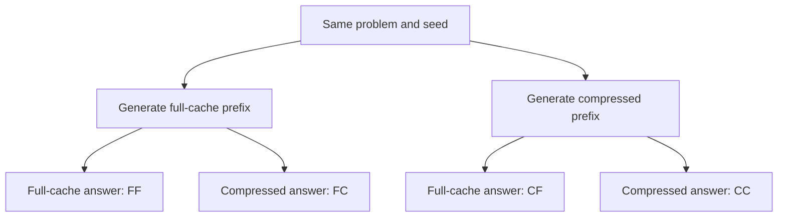
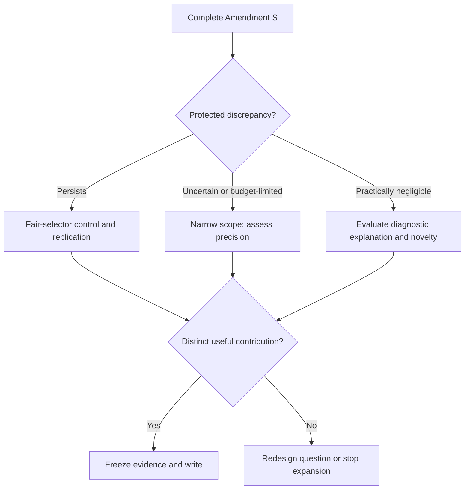

# KV-cache paper: research and publication execution plan

**Version 1.0 · prepared 4–5 October 2026 · baseline commit `1b644dc1ea8792cce7e98f36b18511f078fba129`**

> Committed to the repository on 2026-10-05 as received from the researcher
> (an external reviewer's plan, adopted by the owner as the specification for
> this phase). Text is verbatim. Progress against it lives in
> `docs/paper/EXECUTION_STATUS.md`; claims in `docs/paper/CLAIM_LEDGER.md`.

**Purpose:** give the researcher and Claude Code a concrete, bounded route from the current evidence to the strongest defensible top-conference submission. This is an execution specification, not a prediction or guarantee of acceptance. Scientific outcomes can require a narrower paper or a decision to stop. Successful software tests alone do not establish scientific novelty or validity.

**Recommended direction:** a measurement and evaluation paper about how prompt retention changes the discrepancy between held-trace readout and free-running reasoning under KV-cache eviction. Attention and latent diagnostics support this investigation; they are not assumed to identify its mechanism.

**How to use this document:** read Sections 1–4 for the research argument; execute the work packages in Section 5; use Sections 6–11 as implementation and analysis specifications; follow Sections 12–16 for writing, release and submission. Section 17 is the complete first instruction to paste into Claude Code. Section 18 is the finite completion checklist.

**First working session:** attach this document to Claude Code and paste Section 17. Its immediate deliverables are the status/claim ledgers, the scoring-investigation specification, the protected-result analysis as queued data become available, and the costed new-campaign proposal. Preparing this plan has not launched experiments, changed the repository or approved new resource use.

All paths below are relative to the actual `kv-caching` repository unless explicitly described as proposed. New filenames and command interfaces are proposals, not claims that those files or commands already exist. Claude must adapt extensions to the current repository rather than duplicating existing machinery.

## 1. Decisions made by this plan

1. Finish the already-authorized Amendment S runs and analyses before adding a new GPU campaign.
2. Preserve all original scores, estimators, labels and preregistration history. Corrections are dated and additive; historical labels receive plain-language qualifications where needed.
3. Use **prompt protection × evaluation protocol** as the central comparison. Do not headline “most damage is trajectory drift,” “random is universally better,” or “prompt loss explains everything.”
4. Treat the original unprotected Qwen-7B results as discovery evidence. New comparisons get frozen designs before generation and a separate confirmation status.
5. Address the strongest alternative explanation with a protected H2O-style comparison. Include a genuinely fresh-uniform random baseline before comparing our results with the Random Attention method.
6. Spend further compute on the central comparison in another model and task before expanding SVD/PCA sweeps or restoration variants.
7. Keep Qwen3's frozen-grader bank score at 0.845. Prepare a separate format-aware scoring sensitivity and an explicit resolution of the investigation gate; do not silently turn a new score into a primary PASS.
8. Stop the repeated broad engineering review cycle. Verify new behavior with focused production-path tests and review the final scientific evidence once at a fixed snapshot.
9. Do not invent a new eviction algorithm simply because we want an A* paper. A useful, original evaluation contribution is a legitimate target, but it must advance understanding beyond existing benchmarks.
10. Prepare a main-track submission when the evidence supports it. Neither an attractive title nor the volume of experiments substitutes for significance.

### 1.1 Scope and authority

This document authorizes no action by itself. The present request is to prepare a plan. Claude may continue work already authorized in its session and prepare reversible code, analyses, configs and resource estimates. New GPU campaigns should remain held until their concrete scope and cost fall within an existing authorization or receive one approval. Existing nightly permissions, storage allocation and one-time exceptions persist exactly as recorded.

Do not delete additional files, expand the 72 GiB allocation, start outside the permitted window, publish a paper, submit to a conference or send messages to others merely because this plan mentions those activities. A fifth one-time early start is not standing permission for a sixth. Use approval only where required; do not ask again for routine work already authorized.

## 2. Evidence baseline: what we have and what it means

This plan is grounded in the repository at `1b644dc`, not the older September attachments. Both remotes were verified at that commit during planning. Results below have different levels of independent verification; keep those distinctions in all future status reports.

| Evidence | Current state | Supported use | Limit |
|---|---|---|---|
| Reader repair through `1123ad0` | Reviewed counterexamples rejected through real CLI; valid fixture accepted | Reuse the validation boundary | Not a proof that every possible bug is absent |
| S.1 protected Qwen-7B, B=256 | FINAL; 800 joint condition-table rows; 400 free-run and 392 defined readout pairs per policy | Main discovery result | One model/task/budget; legacy provenance limitations documented |
| S.1 primary and relaxed-budget sensitivity | 36 estimates and CIs independently reproduced from committed sufficient statistics | Numerical foundation | Does not independently regenerate server-only model outputs |
| Protected reverse readout, B=256 | In progress in latest session report | Pending test of replay-direction sensitivity | Live counts and GPU utilization were not independently observed |
| Protected B=1024 | Queued | Determines budget scope | No protected result yet at the planning snapshot |
| Qwen3-4B bank | Reported complete, 169/200; outside [0.85, 0.99] | Investigation, not an accepted primary bank | Raw 31-error audit not yet independently reproduced |
| M, Δ, ω capture | Qwen-7B B=256 and B=2048; Llama comparison available | Scoped diagnostic evidence | Teacher-forced quantities; accuracy mechanism not established |
| Llama ω contrast | Reverses relative to Qwen | Limits generality | Does not isolate architecture as the cause |
| Restoration by origin | Random prompt-plus-padding arm outperforms trace-draw arm | Descriptive divergence intervention | Padding prevents a pure per-prompt-entry interpretation |
| Fork precision validity gate | FAIL: approximately 2.006 against 2.0 | Explicit restriction on affected claims | Do not rename PASS or dismiss solely because the miss is small |

### 2.1 Main verified numerical result

| Policy | Base residual | Protected residual, 95% CI | Paired change, 95% CI | Free-run accuracy, base → protected |
|---|---:|---:|---:|---:|
| Random, legacy implementation | −0.331667 | −0.055833 [−0.098333, −0.015833] | +0.275833 [+0.204167, +0.349167] | 0.4225 → 0.6625 |
| StreamingLLM | −0.337500 | −0.078333 [−0.125000, −0.034167] | +0.259167 [+0.181667, +0.339167] | 0.2375 → 0.6100 |

The magnitudes shrink by approximately 83% and 77%, respectively. These are ratios of descriptive point estimates. They are not fractions of a causally identified mechanism. The residual is evaluated on defined readout conditions, while displayed free-run accuracy uses all conditions; do not reconstruct the paired residual by subtracting rounded table columns with different populations.

Both protected residuals persist under the registered rule. The sensitivity excluding three budget-relaxed problems agrees. Protection improves overall accuracy substantially but leaves substantial full-cache accuracy loss. These are compatible facts.

### 2.2 Diagnostic mismatch, stated correctly

At Qwen-7B B=256, Random has the largest mean M, Δ and ω among the tested policies, not the smallest M or Δ. On the same 25 capture problems, Random and R-KV score 0.37, StreamingLLM 0.25 and H2O-style 0.18. This is a descriptive mismatch between perturbation rankings and accuracy rankings, with substantial accuracy uncertainty at this sample size.

The paired M(H2O-style) − M(Random) contrast excludes zero. That does not automatically establish every pairwise accuracy contrast or a universal failure of M. Compute paired accuracy intervals on the same keys instead of inferring significance from overlapping or non-overlapping marginal intervals. The registered ω contrast against StreamingLLM is exploratory and does not prove a predictive relationship with accuracy.

### 2.3 Wording to fix immediately

| Retire | Replace with |
|---|---|
| “Most of the residual was prompt loss.” | “Prompt protection reduces the measured residual magnitude by about 83%/77% in this setting.” |
| “Random's readout did not need the prompt.” | “A readout effect was not detected for Random; its CI includes both negative and positive changes.” |
| “The prompt is not special for StreamingLLM.” | “The prompt-versus-trace restoration contrast was not detected.” |
| “ω proves the mechanism.” | “ω describes a model-dependent geometric difference; the accuracy connection is not established.” |
| “The reverse bracket proves a causal trajectory effect.” | “Forward and reverse interventions give complementary operational comparisons; a causal bound requires additional assumptions.” |
| “UNCHANGED” means equal | Keep the registered machine label, but explain that the CI includes zero and equivalence was not established. |
| “All gates pass.” | Name software, provenance, bank, numerical and experimental gates separately. |

## 3. The paper's contribution and novelty test

### 3.1 Working research question

**After matching prompt retention and cache accounting, when does evaluation on supplied reasoning traces differ materially from evaluation on generated reasoning, and what does an explicit forward/reverse audit tell us about that difference?**

This asks a measurable question without promising that the remaining effect must be large, universal or causal. It also permits a scientifically useful boundary result: a discrepancy concentrated in particular budgets or policies.

### 3.2 Three candidate contributions

**C1 — Measurement.** A precisely specified set of operational interventions, support rules and estimators for separating held-trace readout from free-generation performance. The value must exceed “also run free generation”: show what the audit diagnoses, how it changes interpretation, and what it costs.

**C2 — Controlled empirical finding.** Matched prompt protection changes the discrepancy substantially; establish the budgets, policies, models and tasks on which a practically relevant remainder does or does not persist.

**C3 — Diagnostic limit.** Quantify when attention-mass, attention-shape and latent-direction metrics disagree with task performance, with matched populations and controls. This supports C1/C2; it need not be a separate universal theorem.

### 3.3 Closest-work matrix to complete before new powered runs

Create `docs/paper/RELATED_WORK_MATRIX.md` (proposed). For each paper record version/date, exact section or table, model, task, budget definition, prompt protection, recency, selection implementation, free-run evaluation, forward/reverse interventions, missing-boundary handling and practical decision demonstrated. Use full papers and official code, not abstracts alone. “Not found in inspected sections” is not “never done.”

| Work | Verified overlap | Our candidate distinction to test |
|---|---|---|
| Random Attention, arXiv:2609.03430v2 | Prompt protection, random eviction, matched-protection comparisons, broad reasoning evaluation | Accuracy-scale intervention comparison and replay-direction sensitivity after protection, not rediscovery that the prompt matters |
| HOTT, arXiv:2512.12008 | Free-running reasoning benchmark; method/task/budget dependence | A controlled evaluation-protocol audit, not merely another accuracy leaderboard |
| The Pitfalls of KV Cache Compression, ACL 2026 | Instruction loss, eviction bias and protective policy changes | Reasoning-trace/readout distinction with matched conditions |
| Canonical H2O, StreamingLLM, R-KV and relevant modern decode evictors | Selection objectives and differing operational assumptions | Exact implementation-aware comparisons, with protection and budget held fixed |
| Exposure-bias and causal-intervention literature | Conditioning on reference rather than policy-generated trajectories | Explicit limits of our operational decomposition; no new name for a known phenomenon without new evidence |

The first three entries are verified overlaps, not a complete literature review. Search newer work through the submission freeze. Do one thorough novelty pass now and one update before submission; do not repeatedly browse instead of completing the study.

**Novelty gate N:** produce a one-page explanation of the new question, why the closest papers do not already answer it, and one experiment that could falsify our answer. If no specific contribution survives, stop broadening the run grid and redesign the question with the supervisor. Do not create novelty by omitting a strong baseline.

## 4. Define the quantities before writing the story

### 4.1 Operational 2 × 2 design

Let F mean full-cache and C mean one specified compressed policy, including its prompt-protection setting. On the same problem/seed design, let:

- A_FF: accuracy with the full-cache-generated reasoning prefix and full-cache answer continuation.
- A_FC: accuracy with that full-cache prefix teacher-forced under C, then answer continuation under C (forward readout).
- A_CC: compressed free-generation accuracy.
- A_CF: accuracy when the compressed-generated prefix is teacher-forced under F, then answered under F (reverse readout).

These definitions require the cache construction and answer boundary to be specified. Teacher-forcing a prefix reconstructs cache states under the readout policy; it does not magically preserve the states from the original generation. Trace generation and answer continuation randomness must be recorded. If stored free-run answers are reused as diagonal outcomes, say so, and validate continuation settings before combining them with re-decoded answers.



On a genuinely common eligible population:

\[
D=A_{CC}-A_{FF},\quad L_{read}=A_{FC}-A_{FF},\quad R_{forward}=A_{CC}-A_{FC}.
\]

Then D = L_read + R_forward by arithmetic. Also:

\[
D=(A_{CF}-A_{FF})+(A_{CC}-A_{CF}).
\]

The replay-direction interaction is:

\[
I=(A_{CC}-A_{FC})-(A_{CF}-A_{FF}).
\]

These are operational contrasts. The two residual-like terms are not automatically upper and lower bounds on an unobserved causal “trajectory share.” Opposite signs, crossed endpoints or strong interaction are valid possible outcomes, not errors to hide. If the manuscript keeps causal language, write its assumptions explicitly and have a human coauthor review the argument. Otherwise call these paired replay comparisons or a descriptive envelope.

### 4.2 Populations and missingness

Keep all scheduled free-run conditions in accuracy denominators, including truncations and no-answer cases under the frozen rule. Readout eligibility depends on a usable source-trace boundary. Forward and reverse eligibility may differ and can depend on policy success; complete-case results alone can be selective.

Report three layers:

1. Full-population free-run accuracy and failure counts.
2. Each operational readout on its declared eligible set, with matched full-cache comparators.
3. A common-support 2 × 2 table plus conservative bounds for omitted outcomes on the frozen target population.

For bounds, assign unknown correctness values within [0,1], preserving known outcomes and equal-problem weighting. Do not count an undefined readout as an incorrect generated answer. Publish excluded keys and reasons. Existing registered analyses remain unchanged; new common-support or bounded analyses are separately named sensitivities.

### 4.3 Practical relevance

Use **3 percentage points** as the proposed primary practical tolerance for new designs, and 1/5 points as declared sensitivity thresholds. This is a proposed scientific choice made after seeing the old B=256 result, not a historical preregistered constant. Freeze it for new data and justify it as an accuracy tradeoff; do not change it to fit results.

On matched support define positive losses F_loss = A_FF − A_CC and R_loss = A_FF − A_FC. A strong “false reassurance” example requires simultaneous uncertainty evidence that R_loss ≤ 0.03 while F_loss > 0.03. If readout itself is already substantially lossy, describe the result as underestimation or protocol disagreement, not a false near-lossless certification.

Use a joint problem-cluster bootstrap or multiplicity-adjusted one-sided bounds for the two statements. Check numerical examples before claiming a pass/fail reversal. Do not claim our custom readout experiment reproduces a published method's evaluation unless that protocol was actually matched.

Equivalence requires its own prespecified procedure, such as a TOST analysis with the corresponding 90% interval within ±0.03, adjusted for the declared family where applicable. A nonsignificant difference is not equivalence. Preserve the original 95% descriptive intervals alongside this new analysis.

## 5. Ordered work packages and exit conditions

### WP0 — Freeze the starting point and make one source of status

**Owner:** Claude Code. **Resource:** CPU/read-only inspection. **Start:** immediately.

1. Fetch both remotes; record current HEAD, parent of the reviewed commit and any subsequent changes. Do not assume HEAD remains `1b644dc`.
2. Read current `CLAUDE.md`, protocol, context, operations, result readers and queue. Treat uploaded September documents as historical where they disagree.
3. Create `docs/paper/EXECUTION_STATUS.md` with one row per work package: owner, dependency, state, artifacts, command, relevant commit, actual resource use and next action.
4. Create `docs/paper/CLAIM_LEDGER.md`: claim ID, exact sentence, source artifact, denominator, estimator, CI, scope, controls, exploratory/confirmatory status and invalidating evidence.
5. Correct the wording in Section 2.3. Mark the abstract as awaiting Amendment S completion; do not leave a known overclaim unqualified while waiting.
6. Record the precise scope of the failed fork-precision gate. Separate accuracy scoring claims from divergence/state-restoration claims that depend on that instrument. Have no software gate silently substitute for it.

**Exit:** a reproducible status snapshot, claim ledger and list of unresolved scientific questions. No new GPU run or full-suite archaeology required.

### WP1 — Finish and read the existing queue

**Owner:** Claude Code. **Resource:** existing authorized GPU work plus CPU analysis.

Run the approved queue using the existing scheduler, resumability, provenance and storage guards. Current planned sequence is protected reverse B=256, protected free-run B=1024 and forward readout, then native Qwen3 cells as dependencies and capacity permit. Verify the actual queue rather than rewriting it from this prose.

Read protected B=1024 through the existing `report_s.py protection --budget 1024` interface with explicit runs root. Read the combined branch with `report_s.py consequence` only after both stored protection reports are FINAL and their dependencies still match. Build a protected reverse report by extending/reusing the existing reverse-readout machinery; do not pretend a `report_s reverse` subcommand already exists.

For every finished analysis: verify exact coverage, controls, eligibility, input fingerprint, sample sizes and coefficient signs; generate the compact condition table; refresh the evidence manifest; publish figures only for validated results. PARTIAL stays unlabelled. INVALID stays invalid and names the offending evidence. Archive stale canonical outputs before analysis.

**Exit:** protected B=256 forward/reverse comparison and B=1024 forward comparison, including support/bounds and sensitivity, or a documented genuine failure. Record the original S branch even if a later, narrower wording is scientifically preferable.

### WP2 — Resolve the native Qwen3 scoring investigation

**Owner:** Claude implements; researcher/supervisor approves the interpretation of the stop rule. **Resource:** CPU only.

1. Export all 200 bank rows, not just 31 errors, with immutable raw-text hashes and grading metadata. Retain server-private text where required; compact evidence must include enough answer context for verification.
2. Independently reproduce 169/200 using the frozen pipeline and verify exact problem/seed coverage. Reproduce the claimed error-category counts; mark each category as confirmed, ambiguous or genuine model error.
3. Publish a dated secondary-scoring specification, explicitly designed after bank-error inspection and before dependent-outcome analysis. Do not call the whole process prospectively preregistered.
4. Implement format-aware equivalence and extraction separately. Apply semantic rules uniformly to correct and incorrect outputs in every compared arm. Never add per-problem string exceptions to reach 170/200.
5. Preserve the original primary grader, raw rows and primary bank FAIL. Secondary score, original score and transition table must coexist.
6. Make a written gate resolution: either permit primary-score dependent analyses as qualified exploratory results after the documented investigation, or keep them held and report secondary analyses under a distinct approved protocol. No unrecorded override, no automatic replacement of the original band.

**Exit:** verified bank audit, secondary scorer specification and tests, row-level score changes with reasons, missing-boundary analysis, and an explicit gate disposition. Generation may continue if already permitted; scientific reading obeys the gate disposition.

### WP3 — Complete the analysis that costs no new model generation

**Owner:** Claude Code. **Resource:** CPU.

1. Build matched-key policy accuracy contrasts on the 25 capture problems. Estimate Random minus H2O-style, Random minus StreamingLLM, and Random minus R-KV using a joint problem bootstrap. Pair mass and accuracy contrasts in the same replicates where source data permit.
2. Distinguish evidence of a policy-mean ranking reversal from evidence that a per-trace metric predicts correctness. Four policy means cannot support a reliable general predictor.
3. Reproduce all primary S.1 contrasts and sensitivity from compact data in a separate analysis implementation. Confirm rounded paper numbers are generated from the chosen estimator, not copied from old pooled reports.
4. Compute practical-threshold results from Section 4.3 without relabelling the original analyses. Record all 1/3/5-point outcomes, including failures to demonstrate a decision reversal.
5. Build the current evidence-to-claim table and one plot of protected versus unprotected gaps by budget. Mark pending results plainly.
6. Complete novelty gate N. Explicitly compare with the exact Random Attention version and with prior protocol/exposure-bias analyses.

**Exit:** a short internal scientific memo selecting the main unanswered comparison, not a request for another open-ended audit.

### WP4 — Build the minimum new experimental capability

**Owner:** Claude Code. **Resource:** CPU, then small approved smoke runs.

Implement protected H2O-style and a fresh-uniform random family as specified in Sections 7–8. Generalize the reader only enough to support explicit design manifests; do not hardcode every new policy into a growing series of scripts. Keep existing S.1 estimands and outputs unchanged.

Add capture support for protected policies if the metric claim is retained. Reuse the frozen Qwen basis and existing instrument; a new basis or new subspace selection is not needed to answer the protected-selector question.

Prepare exact configs, count sheets, frozen IDs, hashes, resource estimates and smoke gates while the old queue completes. Proposed campaign jobs remain held until authorization and the required scientific gate.

**Exit:** valid/invalid CPU fixtures, actual production CLI tests, one identity-matched tiny/model smoke set, estimate of GPU hours and bytes, and no changes to active workers' source environment.

### WP5 — Run one protected-selector discovery extension

**Purpose:** determine whether the original metric/accuracy mismatch survives equal prompt protection and whether legacy Random behavior matters.

Use Qwen-7B, MATH-500, the frozen 100-problem × 4-seed design at B=256 for comparability. This is an extension on an already inspected population, so call it discovery/robustness evidence, not held-out confirmation.

| New cell | Conditions | Reuse | Purpose |
|---|---:|---|---|
| Protected H2O-style free run | 400 | Full-cache bank and existing base H2O-style rows | Fair protection comparison |
| Protected H2O-style forward readout | 400 | Existing reference token traces | Evaluation gap |
| Protected H2O-style reverse readout | Up to 400 scheduled rows, eligibility explicit | New compressed traces | Direction sensitivity |
| Fresh-uniform protected free run | 400 | Existing full-cache comparator | Strong random baseline and legacy-implementation check |
| Fresh-uniform protected forward readout | 400 | Existing reference traces | Evaluation gap under genuine fresh draws |
| Fresh-uniform protected reverse readout | Up to 400 scheduled rows | New compressed traces | Direction sensitivity |
| Capture for legacy Random+prompt, protected H2O-style, fresh-uniform+prompt | 100 each on frozen 25-problem subset | Existing FC traces and Qwen basis | Matched protected M/Δ/ω comparison |

This is 2,400 scheduled free/readout conditions plus 300 capture rows, not 2,400 independent problems. Benchmark cost first; capture may dominate despite its smaller row count. If resources cannot support it, execute the H2O-style block first and explicitly limit modern-random comparisons until the fresh-uniform block is complete. Do not call the incomplete campaign fully comparative.

Do not add B=2048 capture or all four policies by default. A later B=1024 protected-H2O comparison requires a specific conclusion that the B=256 result cannot support and must be registered separately.

**Exit:** an outcome-blind complete read of the planned cells and a decision about whether the metric result belongs in the main paper. No favorable stopping when a curve first looks persuasive.

### WP6 — Confirm the central comparison, not every diagnostic

**Default confirmation scope:** fresh-uniform+prompt and StreamingLLM+prompt; two budgets (256 and 1024); forward and free-run comparisons at both budgets; reverse at 256. Use a native Qwen3-4B model on MATH-500 and a second task, GSM8K, on the anchor Qwen-7B model. These two extensions separately test model transfer and task transfer; they do not establish the complete model × task interaction.

For an extension to count as new confirmation, freeze a problem list not used to choose that extension's outcome claim. Audit all earlier use of those problems, including earlier results beyond Meeting 3. Where no clean holdout remains, label the extension prospective replication on previously inspected material rather than pretending it is untouched.

Initial design planning target is 100 distinct problems × 2 generation seeds per extension. Section 9 determines whether this sample is sufficient and fixes the actual N before outcomes. Two selectors × two budgets give 800 free-run conditions, 800 forward readouts, 400 reverse readouts at B=256, plus 200 full-cache references per extension: **2,200 scheduled conditions per extension at N=100 and two seeds**. Reuse banks only when their IDs, model revision, prompt, sampling, cap, scoring and support match exactly.

Use seeds 11 and 23 for new extension planning unless an already registered design requires four seeds. Do not alter the four-seed historical designs. More independent problems generally take priority over multiplying seeds when the inferential unit is the problem.

Task pilot: verify the GSM8K data adapter, answer format and full-cache behavior before any compression outcome. Freeze failure criteria and grader rules first. If the task is unusable, report the pilot and propose a new design rather than trying benchmarks until the desired discrepancy appears. Do not discard hard, short, long or failed instances after inspecting compressed outcomes.

If the Qwen bank investigation cannot be resolved, hold native-model confirmation and state that limitation. Do not quietly substitute a different model after seeing a disappointing result.

This confirmation matrix tests whether a discrepancy remains under protection. It does **not** estimate the amount by which protection reduces the discrepancy on the new model/task, because it does not contain every corresponding unprotected arm. If cross-setting protection-effect transfer becomes a main claim, add and cost matched unprotected counterparts prospectively; do not use legacy Random as the unprotected counterpart of fresh-uniform Random.

**Exit:** complete replication results with all outcomes reported. If affordable N cannot support the intended precision, report uncertainty and narrow the claim rather than adding seeds until significance appears.

### WP7 — Write and release the paper

Follow Sections 12–16. Start methods, related work, table shells and figure specifications while jobs run. Write the conclusion-bearing abstract only after the evidence snapshot is frozen. A new round of exploratory GPU studies is not a prerequisite if the main claim is already supported and remaining questions are clearly outside scope.

## 6. Outcome gates: how the plan changes with the evidence



| Gate | Pass condition | If it does not pass |
|---|---|---|
| Engineering | Expected coverage, controls, identity and valid data; demonstrated restart behavior | Fix the specific defect; keep affected reports INVALID |
| Bank investigation | Explicit documented resolution under the original stop rule; primary/secondary scoring separated | Dependent claims remain held |
| N: novelty | A precise distinction from closest full papers and a falsifiable experiment | Do not run a broad confirmation grid |
| Practical relevance | Prespecified meaningful discrepancy or demonstrated evaluation decision change, with uncertainty | Describe scope/precision honestly; do not substitute p<0.05 for usefulness |
| Generality | Same central comparison examined across the selected extensions, with heterogeneity reported | Limit claim to the supported settings |
| Metric contribution | Protected matched-key comparison is informative and adds understanding beyond C1/C2 | Move diagnostics to appendix, including null/reversed outcomes |
| Manuscript readiness | Every central sentence supported; no unresolved core gate; independent cold read and reproduction | Resolve a finite issue list, not another unspecific review loop |

A registered label such as PERSISTS is not itself the practical-relevance gate. If both budgets show small but precise effects, quantify their practical size. If B=1024 is inconclusive, do not say the effect vanished. If evidence supports practical equivalence under the prespecified procedure, that is stronger than merely including zero.

The original S.1 branch C is already incompatible with the verified B=256 PERSISTS outcomes unless a genuine data correction changes them. Keep the original branch map for provenance, but do not discuss every historical branch as equally open now.

## 7. Implementation specification for Claude Code

### 7.1 Extend the repository; do not replace the working system

| Existing component inspected | Reuse/extension | Proposed new artifact if needed |
|---|---|---|
| `src/kvcache/presses/prompt_protect.py` | Existing positional protection and live retention assertions; keep historical Random/StreamingLLM behavior | Separate module for additional protected selectors so old generation identities remain interpretable |
| `src/kvcache/read_validation.py` | Coverage, restoration and capture controls; dependency fingerprints; finite-domain checks | Small extensions for new schemas only |
| `src/kvcache/coverage.py` | Equal-problem paired bootstrap | New simultaneous contrast/support helpers with distinct names |
| `scripts/run_grid_pp.py`, `scripts/run_replay_pp.py` | Current free-run/forward orchestration | Shared adapter for new selector family; no copied runner per policy |
| `scripts/run_replay.py`, `scripts/report_m4.py` | Existing reverse path and accuracy analysis | Explicit forward/reverse common-support report |
| `scripts/run_capture.py`, `scripts/run_capture_v2.py` | Capture infrastructure | Protected-policy adapter, without changing old capture outputs |
| `src/kvcache/provenance.py`, `src/kvcache/gates.py` | Input identity, basis/gate checks, atomic evidence | New family version and manifest schema where inputs differ |
| `scripts/postprocess_meeting3.py`, `scripts/nightly_autorun.py` | Validated reader → figures → manifest → acceptance marker | Registered stage for new paper analyses |
| `scripts/build_paper_numbers.py`, `scripts/audit_paper_numbers.py`, `paper_claims.json` | Numeric and claim traceability | Extend with new supported claims; preserve old source IDs |

Before changing a component, read its current interface and tests. Source files in this review workspace are snapshots, not the authoritative working checkout. The actual repository may contain later functionality.

### 7.2 New design manifests

Create proposed `configs/paper/` manifests rather than selecting expectations from observed rows. A design must record:

- design ID and version, dated protocol entry, scientific question and inference family;
- model ID/revision, tokenizer revision, chat template and reasoning mode;
- dataset revision, problem-list path/hash, split and prior-exposure status;
- policy family/version, protection rule, recency rule, cache budget accounting, compression interval;
- generation seeds, RNG construction, decoding temperature/top-p, token cap and stopping rule;
- full-cache reference and trace IDs, scoring and boundary-parser versions;
- expected condition keys for every stage, including conditions expected to be ineligible;
- primary contrast, secondary analyses, missingness rule, numerical tolerances and practical margin;
- GPU-hour/byte estimate, job dependencies, smoke-gate identity and authorization state.

Illustrative schema only; build the parser before treating it as an executable config:

```yaml
design_id: protected_selector_q7_math_b256_v1
status: PROPOSED_HELD
scope: discovery_extension
model: r1_distill_qwen_7b
problem_manifest: configs/meeting3/grid100_pids.json
seeds: [11, 23, 47, 89]
budget_total_after_prune: 256
compression_interval: 64
prompt_protection: all_prompt_positions
min_trace_slots: 64
budget_relaxation: prompt_length_plus_min_trace_slots
policies: [h2o_style_pp_v1, uniform_fresh_pp_v1]
primary_practical_margin: 0.03
stages: [free, forward, reverse]
existing_comparators: [random_pp, streamingllm_pp]
```

Pin exact model/source revisions in the implemented manifest; the illustrative snippet intentionally avoids inventing revision hashes. `scale_authorized: true` is not evidence of user authorization and must never be used to manufacture it.

### 7.3 Protected H2O-style

Keep the exact existing H2O-style score definition. Protect entries by absolute token position, per layer and KV head; never assume compacted slot index equals sequence position. Select the protected prompt first and apply the existing score to the remaining candidates within the declared target budget. Make tie handling deterministic and stable. Do not insert recency protection or accumulation that the base variant lacks.

Record whether “H2O-style” means observed current attention or an accumulated heavy-hitter score. This repository's observed-attention implementation must not be presented as canonical accumulated H2O. If reviewers' anticipated objection requires canonical H2O, specify that as a separately named comparator and cost it before launch; do not change the existing policy underneath a familiar label.

Use the S.1 total-budget rule for the matched comparison: prompt entries occupy the same budget; only the already specified minimum-trace exception expands it, with the corresponding exclusions/sensitivity. A mask that leaves every prompt score maximal but accidentally returns more than the target is a failure.

Acceptance requirements: every prompt entry survives; no duplicate positions; retained cardinality equals target; no out-of-range positions; K/V/position/attention-score metadata stay aligned; with protection disabled the adapter reproduces the base policy's selection and outputs on a fixed fixture; forced short prompt and long-prompt relaxation both behave as specified.

### 7.4 Fresh-uniform random baseline

Historical `random` and `random_pp` remain unchanged and retain the label “legacy Random” in implementation-sensitive comparisons.

Implement `uniform_fresh_pp_v1` with genuinely fresh draws at each eviction, independent across layers and KV heads, sampling without replacement among eligible generated-token positions. Its protected prompt rule, total budget and recency rule must be explicit. Use a dedicated RNG/key derived from `(master_seed, problem_id, generation_seed, layer, KV_head, prune_index)` and a stable hash/encoding; never Python's randomized process hash. Do not reset global sampling RNG. Include prune index so each step is not the same slot pattern repeated.

Ensure resumed execution recreates the same draw sequence: either derive draws statelessly from the full key or checkpoint the dedicated generator state and prune counters. Deterministic replay must refer to the same logical positions after compaction. Device/precision and tie behavior should not silently alter the policy.

Test fixed-key determinism, changed-prune draws, selection cardinality, no duplication, prompt retention, resume equivalence and independence from the language-model sampling RNG. A CPU Monte Carlo inclusion-frequency check on a tiny candidate set can test approximate uniformity with a prespecified broad bound; it is a distribution check, not a test that two draws can never coincide.

**Two comparison levels:** (i) a fresh-uniform policy in our matched retention framework, isolating the randomization semantics; (ii) a faithful Random Attention reproduction if we claim direct comparison with that paper. The upstream method has its own persistent budget and protected recency buffer. Verify actual code and convention; match total resident/peak cache entries rather than equating two config values named “budget.” If our variant differs, call it a variant. Do not claim parity with a paper from a home-built approximation.

### 7.5 Capture under prompt protection

Run each compared protected policy on identical full-cache teacher-forced token traces and the same frozen basis. Preserve M, Δ, M_event, per-layer/head/group counts, and eligibility flags. New rows also record prompt retained fraction, trace retained count, effective target and budget-relaxed flag.

Use streaming summaries rather than dense attention maps. Store enough per-condition statistics to reconstruct every reported contrast, plus a small fixed diagnostic sample for inspection. The output budget must include any head-level statistics before scheduling.

Report metric and accuracy contrasts on exactly the same problem/seed population. Teacher-forced reference attention is a diagnostic under that intervention; do not describe it as attention on the policy's actual free-running trajectory. No extra on-policy capture campaign is required by this plan.

### 7.6 Reader and artifact contracts

Proposed new reader: `scripts/report_protocol_audit.py`, with internal pure functions in `src/kvcache/metrics/protocol_audit.py`. Reuse existing functions where behavior matches. It should accept a design manifest, runs root and output directory. Suggested modes: `paired`, `reverse`, `decision`, `replication`; these are to be implemented, not currently valid commands.

Every result must include:

- FINAL/PARTIAL/INVALID and a separate scientific outcome;
- expected/present/duplicate/unexpected keys and exclusions by reason;
- eligible problem/seed counts for each estimand and common-support analysis;
- model/config/code/input/scorer/parser identities and direct data hashes;
- means, paired contrasts, CIs, estimator definition and multiplicity family;
- operational gate results and applicable scientific caveats;
- per-condition sufficient-statistics path/hash and exact reproduction command.

Use fields such as `analysis_status`, `primary_gate_status`, `secondary_analysis_status` and `claim_scope` where one overloaded `passed` would confuse software correctness with scientific outcome. A complete analysis can conclude that the hypothesis failed.

Compute the full dependency set, including code imported by the analysis, frozen designs, graders, boundary parsers, full-cache references, token sidecars and comparator rows. Reuse the repository's established import/dependency discovery where suitable; do not regress to an incomplete hand-maintained list. Publish via atomic write/rename after validation; retire old canonical results before attempting a refresh. A malformed input must never leave a stale FINAL as current.

### 7.7 Minimum production-path test matrix

These are acceptance cases for new behavior, not a request to rerun the entire historical audit indefinitely:

| Area | Test cases |
|---|---|
| Coverage | Missing key → PARTIAL; duplicate/unexpected key → INVALID; undefined rows still counted |
| Values | NaN/Inf/out-of-domain score, malformed metric shape, negative/fractional counts → INVALID |
| Identity | Changed config/model/scorer/reference/basis where relevant → refused resume or stale analysis |
| Restart | Interrupted row, deterministic resume, no duplicate completed key |
| Controls | Failed retention/selection/control gate cannot produce a scientific label |
| Comparators | Mutated full-cache or reverse-source row invalidates cached analysis |
| Missingness | Forward-only, reverse-only and no-boundary conditions enter the correct supports and bounds |
| Scoring | Correct→incorrect and incorrect→correct secondary transitions both retained; ambiguous extraction not silently repaired |
| Statistics | Known paired fixture; unequal seeds per problem; zero differences; opposite-sign endpoints; floor/ceiling |
| Output | Torn input retires old FINAL; failed figure/manifest refresh does not accept an incomplete stage |

Run through the real subprocess CLI and actual manifest updater for end-to-end cases. A valid complete fixture must still finish FINAL. Failures should name the condition and failed contract. After the focused suite passes, run the existing full lint/test/dry-run gates once before integration, using fail-fast execution or explicit checked return codes. Do not chain failed gates with semicolons and then push.

## 8. Qwen secondary-scoring specification

### 8.1 Separate scoring from answer-boundary detection

Keep three independent fields: `has_usable_boundary`, `extracted_answer`, and `correctness`. A correct-looking expression inside an unfinished reasoning span is not automatically a valid readout boundary. Keep the four truncated cases under the frozen rule; audit the seven other unclosed-thinking cases without assuming they are correct final answers.

Proposed artifacts:

- `docs/protocol/QWEN_SCORING_SENSITIVITY.md`: dated rules and outcome exposure.
- `src/kvcache/grading_sensitivity.py`: deterministic format/equivalence logic.
- `scripts/audit_qwen_scoring.py`: immutable raw evidence → primary/secondary scores and transition table.
- `results/diag/qwen_scoring/bank_audit.json` and `bank_audit.conditions.tsv`.
- Unit and real-CLI acceptance fixtures with positive and adversarial negative examples.

### 8.2 Permitted rule categories

1. **Formatting wrappers:** normalize semantically empty LaTeX wrappers around text answers, preserving actual content. Verify that a wrapper denotes content rather than units that may matter.
2. **Unordered collections:** compare order-insensitively only when the answer type is a set or the question requests unordered solutions. Preserve tuple coordinates, intervals, matrices and ordered multipart answers.
3. **Multipart final answers:** combine boxes only within a deterministically identified final-answer construction or labelled answer parts. Do not collect every box from the chain of thought. Preserve order when the task requires it.
4. **Numeric/algebraic equivalence:** reuse vetted existing behavior or a pinned, sandboxed symbolic library with bounded parsing. Do not execute model text. A new dependency must be justified and tested rather than added to rescue a few cells.
5. **Ambiguity:** mark unresolved; retain primary correctness and report sensitivity bounds. Do not let a language model freely adjudicate cases to reach the bank band.

Do not erase `52_8`'s base information to match `52`. Whether the model's answer is sufficient depends on the problem's semantics, not visual resemblance. Avoid manually choosing the interpretation that makes an answer pass.

### 8.3 Evidence and comparability

Score all bank and dependent outputs, not just previously incorrect rows. Emit before/after extraction, before/after score, rule ID and a hash of the supporting text. Have the researcher or another person check every changed and ambiguous bank score with policy/seed outcomes hidden where practicable. The inspection cannot become retrospectively blind; describe what was already seen.

Record a secondary rule as evidence-based only after checking false positives as well as rescued errors. Include adversarial tests for ordered versus unordered answers, embedded units/bases, intermediate boxes, contradictory final answers and plausible but incomplete multipart outputs. A secondary score that increases accuracy is not automatically a more accurate grader.

Apply the same secondary rules to matched anchor-model outputs used in any cross-model comparison. Full rescoring of unrelated historical experiments is unnecessary if those comparisons are not made. Preserve the frozen grader as the primary cross-model reference and report secondary disagreement transparently.

If secondary scoring changes the estimated residual, use matched primary and secondary populations and explain how boundary support changed. Do not present a change caused by including different conditions as a pure grading effect.

## 9. Statistical analysis and sample planning

### 9.1 Fixed inference conventions

- Infer across problems, with seeds nested within problem. Average seeds within each problem, then problems; use paired problem-cluster resampling for contrasts.
- Resample all policies/protocols jointly for paired or joint claims. Keep row pairing throughout a replicate.
- Existing registered results retain their original 2,000 replicates, seed 0 and quantile convention. New confirmation may use 10,000 replicates for more stable tail estimates, fixed before outcome analysis.
- Name primary hypothesis families. For a small family of protected-gap tests use Holm-adjusted testing or a prespecified simultaneous-bootstrap procedure; show unadjusted effect sizes/CIs as descriptive intervals with clear labels.
- Freeze one primary metric per question. Do not try M, Δ, ω, per-layer variants and multiple truncation definitions and highlight whichever yields significance.
- Keep all exclusions, scored failures, truncations and boundary failures visible. Avoid conditioning new tests on “correct full-cache answers” unless that conditional estimand was declared and also show the unconditional population.
- Report both signed harmful and beneficial accuracy flips. Probability/distribution divergence is not correctness loss.
- Do not mix pooled historical estimates with new equal-problem estimates under the same label.

### 9.2 Sample-size procedure before new confirmation

Build `scripts/plan_paper_sample_size.py` (proposed) using existing discovery data only to estimate variance/cost. It should simulate planned problem-cluster designs for N = 100, 200, 300, 400 and, if available, 500 distinct problems, with two versus four seeds. Include effect sizes 0, 0.03 and 0.05 and observed nuisance variability. Report precision and power as planning approximations, not promises that a new model/task has the same variance.

Choose the smallest feasible design that targets a 95% CI half-width around 0.025 or better for the primary paired gap and approximately 80% power for a 0.05 effect. These are planning criteria, not publication requirements. If neither is feasible, choose a fixed attainable N, state the expected uncertainty, and constrain the claim. Never assert “100 problems is enough” without this calculation.

For illustration, a rough problem-level normal approximation uses `N ≈ (1.96*s/h)^2` for half-width h, where s is the SD of paired problem means. Use simulation for the actual paired/clustered design; rounding and bounded binary outcomes matter. A 5-point effect can require hundreds of independent problems. Four seeds do not turn 100 problems into 400 independent experimental units.

Freeze N, seeds, resource ceiling and analyses before new condition outcomes. If adaptive sample-size re-estimation is needed, prespecify a blinded variance-only procedure and its maximum N; do not repeatedly inspect p-values and add data until a desired result appears.

### 9.3 Metric-to-accuracy analysis

Primary evidence is a paired policy comparison, not a scatterplot through four policy means. For a protected Random versus H2O-style mismatch, define contrasts with coherent direction: less mass loss under H2O-style but lower accuracy under H2O-style. Assess both with a joint paired bootstrap and report uncertainty on the same keys.

Per-condition predictive modeling is secondary. If attempted, split by problem, keep all seeds of a problem together, include budget/policy/model and reference-length baselines, and assess held-out improvement over those baselines. Do not use the generated length as an unexamined pretreatment control: it can be affected by the policy. Label post-treatment descriptive adjustments accordingly.

Do not fit a flexible “better metric” on the same 25 problems and present it as a discovery validated there. Existing bridge results already failed to establish the proposed predictive link; report that and avoid post-hoc layer hunting.

### 9.4 Optional uncertainty on the shrinkage percentage

If 83%/77% appears in the abstract or headline figure, calculate a paired problem-bootstrap interval for `1 − |R_protected| / |R_base|`, retaining shared draws. Inspect denominator stability and sign changes; if the ratio is unstable, use the absolute paired improvement as the headline instead. Do not report the point percentage as a precise mechanistic share.

## 10. Compute, storage and scheduling

### 10.1 Existing constraints

Use the recorded 72 GiB combined allocation for the two KV folders, counting hardlinks once and retaining the 1 GiB margin. Measure the current footprint; do not reuse an old 41.952/69.19 GiB number as current. Preserve completed raw data and model revisions necessary for reproducibility. No additional deletion or allocation change is assumed.

The normal GPU window is 01:45–10:45 Dubai, with jobs stopped at 10:43. This is 02:45–11:45 in Pakistan, with the stop at 11:43. Two GPUs would provide at most about 18 GPU-hours per normal night before loading, gates and gaps; this is an upper capacity figure, not a throughput guarantee.

Do not modify a source environment beneath running jobs. Prepare changes in an isolated worktree or versioned deployment, record the exact generation-code identity and switch at a safe boundary. Documentation/results may be published separately from generation code. Existing server publication credentials and human/session steps remain as configured.

### 10.2 Estimate before scheduling

Create `results/diag/paper_plan/cost_estimate.json` and a human-readable table. For every proposed cell list rows remaining, prompt/trace-length distribution, time per row or token, p50/p90 runtime, model load time, peak VRAM, disk bytes, dependencies and total GPU-hours.

Use existing comparable logs first. Where unavailable, use a fixed 8-problem engineering pilot spanning short/medium/long full-cache trace lengths, with one seed and all relevant paths. Pilot IDs are excluded from new confirmatory claims. Log failures; never replace pilot instances because their treatment effects are inconvenient.

Estimate GPU-hours as summed row costs plus initialization and expected replays; estimate calendar windows from the actual job graph and allowed capacity. Multiply storage estimates by at least 1.5 for a planning reserve, while retaining the existing operational margin. Include partial outputs and currently running jobs' remaining reservation.

**Resource gate:** present one concrete campaign budget for approval where needed. The approval item contains the exact cell manifest, hours, bytes, code/gates and scientific purpose. Do not seek a new approval for every seed. If a campaign exceeds its approved ceiling, checkpoint it and report the deficit; do not silently reduce N or extend the window.

### 10.3 Recommended scheduling order

1. Finish existing protected/reverse and Qwen generation work already authorized.
2. Run CPU scoring, analysis, novelty and sample-planning work while GPUs are occupied.
3. Run small identity/correctness smokes for new protected H2O-style and fresh-uniform code after the generation environment can safely switch.
4. Run WP5's H2O-style block, then fresh-uniform block, then compact capture; allow tail filling without starving a required dependency.
5. Read WP5 completely; freeze the confirmation specification once, using the outcome branches already declared.
6. Run WP6 native-model and second-task confirmation within the approved resource ceiling.
7. Stop exploratory GPU work at the evidence freeze. Use remaining time for numerical reproduction, writing and review.

If the protected result is too small/uncertain or novelty gate N fails, do not automatically run all of WP6. Record the gate outcome and revise the paper direction before spending the confirmation allocation.

### 10.4 Monitoring contract

Each scheduler tick should distinguish waiting on dependencies, waiting on free GPU, blocked by storage, stopped by timer, failed control, invalid data and completed analysis. Report last progress timestamp and next launchable job. A seed never launched is not a crashed seed. A subprocess exit 0 is not a scientific completion marker.

Daily report: commit/code identity; completed/new/remaining rows; live process evidence with timestamp; gate statuses; storage used/reserved; accumulated GPU-hours; next action. Commit compact evidence at stage completion, not only prose. Do not promise continuous monitoring unless an actual persistent job exists, has been checked, and remains within the authorized operational setup.

## 11. Evidence release and reproducibility

The compact public/reviewer package should support recomputing each table without GPU access. Preserve a separate restricted/raw archive for regeneration and detailed error review.

Proposed contents under `results/diag/paper_audit/`:

- one design-index JSON referencing immutable config/problem/code hashes;
- validated per-condition tables for each accuracy/readout/metric analysis;
- score-transition and missing-boundary tables;
- human-readable result summaries with status and scope;
- recorded gate reports and analysis logs;
- figure-source data and exact commands;
- an index of raw server artifacts with paths, sizes and hashes, plus the permitted retrieval procedure.

For each number in the manuscript, `paper_numbers.json` should identify its artifact, key, estimator and rounding rule. `paper_claims.json` should identify the evidence and scope for the associated sentence. Do not treat string matching between manuscript and JSON as validation of the underlying scientific interpretation.

Create a CPU reproduction command that rebuilds the main tables and plots from committed compact evidence. Test it in a clean environment with pinned dependencies. Provide a separately documented GPU regeneration path with realistic runtime and storage expectations. Do not claim full reproducibility from compact summaries if raw traces needed for scoring are unavailable; state the division explicitly.

Do not commit model weights, private credentials, personal machine paths or unnecessary personal information. Review dataset/model licenses and redistribution restrictions for any raw release. Preserve sufficient answer context for reviewer audit where permitted. An anonymized release should exclude git history and metadata that reveal author/session details; never rewrite the research history just to hide scientific changes.

## 12. Manuscript architecture

### 12.1 Working title and one-sentence argument

Neutral working title: **“Auditing KV-Cache Eviction: Prompt Retention, Readout, and Free-Running Reasoning.”**

A stronger title such as “What Held-Trace Evaluation Misses After Prompt Protection” is justified only when the completed evidence supports a meaningful remainder. Avoid “Near-Lossless” in the title unless the stated baseline/protocol actually meets a declared near-lossless criterion. Avoid a title that implies every compression method or every model behaves like the original unprotected Random cell.

Working argument: **Evaluation conclusions about KV-cache eviction depend on both the trajectory supplied to the model and the information protected in its cache; an explicit intervention audit quantifies that dependence and identifies the settings where held-trace performance remains an incomplete guide to free-running accuracy.**

Treat this as a candidate thesis to narrow after results, not a sentence Claude must make the data support.

### 12.2 Main-text outline

| Section | Question it answers | Required content | Exclude from the main argument |
|---|---|---|---|
| Abstract | What is new and why does it matter? | One precise result, controlled protection effect, remaining scope, practical contribution | Laundry list of diagnostics; unpublished pending claims |
| Introduction | Why is this an unresolved evaluation problem? | Concrete matched example; closest-work distinction; 3 contributions | Blanket claim that prior work never free-runs |
| Related work | What did others already establish? | Prompt protection, reasoning benchmarks, eviction objectives, exposure bias | Straw-man “everyone uses perplexity” story |
| Protocol and estimands | What exactly is compared? | 2 × 2 diagram; budget conventions; support; scoring; operational limits | Causal language without assumptions |
| Controlled main results | What changes under protection? | Protected/unprotected at 256/1024; paired CIs; missingness and relaxed-budget sensitivity | Combining unmatched denominators |
| Fair selectors and transfer | Does the conclusion survive obvious alternatives? | Protected H2O-style, fresh-uniform, native model, second task | Claims of broad universality from two extensions |
| Diagnostic analysis | What do M/Δ/ω add? | Matched contrast and bounded interpretation; reversal/null evidence | Metric mining or unsupported mechanism narrative |
| Practical use and limits | What should another researcher do differently? | Decision example, audit cost, recipe, validity restrictions | “Just measure everything” without benefit |
| Conclusion | What follows, at what scope? | One supported conclusion and usable evaluation rule | New hypotheses presented as findings |

Use the target venue's actual page limits when available. A sensible allocation is roughly 15% introduction/related work, 20% protocol, 40% results/replication, 15% diagnostic/practical analysis and 10% limits/conclusion. This is an editorial guide, not a forced layout. Do not squeeze key caveats into unreadable footnotes to fit every old experiment.

### 12.3 Abstract construction after results freeze

Write five functional sentences or short units:

1. Identify the specific evaluation ambiguity, citing established background in the introduction rather than overstating novelty in the abstract.
2. State the controlled audit and which dimensions it holds fixed.
3. Give the strongest matched numerical finding, including prompt protection and exact scope.
4. State the supported cross-budget/model/task outcome, including a meaningful limitation when needed.
5. State the practical contribution and released artifact.

Do not lead with 83%/77% if the uncertainty/ratio qualification makes it distracting; the absolute protected and unprotected gaps may be clearer. If replication is mixed, say “we characterize when” rather than “we establish that all.” If no near-lossless decision example exists, do not claim certification failure.

### 12.4 Story branches after completed data

| Completed evidence | Appropriate story | Wording to avoid |
|---|---|---|
| Meaningful protected discrepancy at both budgets and transfer settings | Protocol discrepancy survives prompt protection over the tested range | Universal intrinsic reasoning damage |
| Persists mainly at 256; small/equivalent or uncertain at 1024 | Boundary of the evaluation discrepancy under stronger compression | “It disappears” when only nonsignificant |
| Selector mismatch disappears after protection | Retention rules explain an important comparison dependence; assess novelty against prior work | Retrospective claim that we isolated a unique prompt mechanism |
| Models/tasks disagree | A measured limitation of surrogate/protocol transfer, if systematic and adequately powered | Architecture identified as cause |
| Results remain noisy or novelty overlaps heavily | Narrow technical report, replication paper or further targeted redesign | Cosmetic reframing as a major general discovery |

An A* submission is not made strong by hiding unfavorable branches. A precise negative or boundary result can be valuable, but its significance must be demonstrated independently of the effort invested.

### 12.5 Main/appendix allocation

**Main:** protocol diagram, protected-gap comparison, fair-selector comparison if informative, central replication, practical consequence and most consequential limitations.

**Appendix:** full cache-size curves, all registered branches, legacy-versus-fresh implementation details, grading transition evidence, full M/Δ/ω tables, restoration padding details, null collateral, unsuccessful bridge tests, numerical-gate diagnosis, sensitivity analyses, extended method versions and resource costs.

Do not remove inconvenient experiments from the archive. Relocating evidence to the appendix is an editorial choice; selectively suppressing it is not.

## 13. Figures and intuitive diagrams

Use precise vector diagrams and standard plotting tools; do not generate scientific plots or exact cache diagrams with an image generator. Build all figures from versioned data, with readable legends, consistent color/shape semantics, explicit units, and vector PDF/SVG plus PNG previews. Inspect the rendered manuscript at ordinary reading size.

| Figure | Visual construction | What the reader should understand |
|---|---|---|
| 1. Protocol and cache semantics | Two compact panels: 2 × 2 source-prefix/readout-policy diagram; cache strip distinguishing prompt, retained trace and evicted trace | Why holding the reasoning fixed changes the experiment; how protection consumes the same cache budget |
| 2. Main protected comparison | Four panels: two policies × two budgets; base/protected paired residual estimates with CIs; separate accuracy panel or companion table | Protection shrinks the discrepancy; whether a remainder persists |
| 3. Fair-selector evidence | Paired contrasts for lost mass and free-run accuracy under equal protection; avoid incompatible scales on one axis | Whether preserving more mass ranks performance correctly in the controlled comparison |
| 4. Replication and practical margin | Forest plot grouped by model/task/budget; shaded ±0.03 practical region; explicit sample counts | Generality, heterogeneity and practical size |
| 5. Forward/reverse support | Common-support endpoints plus eligibility counts; no causal-bracket label without justification | How replay direction and unavailable boundaries affect interpretation |
| Appendix A. Budget/retention audit | Effective/peak/resident cache against steps, representative fixed examples | Equal nominal budgets need not mean equal memory |
| Appendix B. Grader sensitivity | Primary-to-secondary transitions and boundary-status breakdown | Which scores changed and why |
| Appendix C. Diagnostic limits | Layer profiles, Llama reversal and original null tests | Geometry is model-dependent; not a universal accuracy predictor |

If the page limit permits only four main figures, combine Figure 5 with Figure 1 or the main comparison without shrinking labels excessively. Do not invent decorative diagrams that convey no evidence. Include intuitive cache strips and intervention arrows alongside the statistical plots, as requested by the researcher.

Figure checks: axes and sign conventions match the text; all numbers derive from artifacts; CIs use the stated estimator; captions identify the population; missing values are marked unavailable rather than zero; confidence intervals are not presented as individual-trace variation; colorblind-readable colors and marker shapes are consistent across the paper. Every figure must stand alone enough for a reader to understand its main claim from the caption.

## 14. Reviewer objections and concrete answers

| Likely objection | Work needed before submission | Honest fallback |
|---|---|---|
| “This repeats Random Attention.” | Full-paper novelty matrix; post-protection protocol comparison and practical decision evidence | Narrow to a replication/diagnostic extension if no distinction survives |
| “This repeats HOTT.” | Show what the controlled interventions add beyond free-run ranking | Do not sell another accuracy table as a new protocol |
| “It's just exposure bias.” | Quantify the operational discrepancy; reverse/common-support analysis; clear estimand limits | Treat it as a measured evaluation issue, not a newly discovered causal phenomenon |
| “The prompt was being evicted.” | Protected policies with equal accounting; report the new smaller gaps | Scope old claim to unprotected policies |
| “Your Random is not actually fresh uniform.” | Explicit family names, retention audit, fresh-uniform comparator | Limit conclusions to the legacy implementation |
| “That is not canonical H2O.” | Exact implementation description and upstream comparison | Use H2O-style throughout; no canonical-algorithm claim |
| “The budget comparison is unfair.” | Total/peak/average cache reporting; prompt and recency allocation; relaxed-budget sensitivity | State distinct protocols rather than implying a matched comparison |
| “Only one model/task/extreme budget.” | Targeted confirmation and B=1024 result | State limited scope; no universal claim |
| “The grader creates the result.” | Frozen primary plus uniform secondary scoring; changed-row audit and support checks | Report score dependence and unresolved cases |
| “You dropped failed or boundary-less cases.” | Full-population accuracy, explicit eligibility and bounds | Restrict the readout claim to its identifiable population |
| “Metric rankings don't prove prediction.” | Paired joint contrasts; optional held-out analysis by problem | Keep the result descriptive |
| “A control failed.” | Claim-specific validity map; retain FAIL and remove unsupported dependence | Omit affected mechanistic claim from main contribution |
| “Why not simply measure free-run accuracy?” | Demonstrate an interpretation/selection decision the audit improves, with measured cost | Admit the audit adds diagnosis rather than a cheaper correctness certificate |
| “Results were selected after inspection.” | Dated discovery/confirmation split, frozen manifests, complete outcome reporting | Label exploratory and lower the strength of claims |
| “The package cannot be reproduced.” | Clean CPU rebuild from compact data and documented raw-data access/regeneration | State the exact reproducibility limit |

Use this as a finite pre-submission checklist. Do not respond to every hypothetical objection with a new GPU sweep. A scoped answer and an explicit limitation can be the correct response.

## 15. Human review, venue and submission

### 15.1 Human responsibilities that Claude cannot assume

The researcher and supervisor/coauthors own the scientific argument, gate-resolution decisions, authorship, venue choice and final submission. Claude can implement, calculate, check consistency and draft. Every author must be able to explain the estimator, why the comparisons are fair, the closest competing contribution and the strongest limitation without relying on an agent's assurance.

Before submission, have one technically capable person who did not implement the readers reproduce the main table from compact evidence and one domain reader assess novelty and claim scope. These are defined review tasks, not endless rounds of “check everything.” No external person is contacted by this plan without permission.

### 15.2 Venue direction

Prepare the scientific core for a general ML or NLP main track. ICML/NeurIPS are plausible fits if the contribution is a broadly useful measurement method with convincing transfer; ACL is a plausible fit if the strongest result is specifically about evaluating language-model reasoning. This is a fit assessment, not a verified ranking statement or acceptance forecast. Confirm the institution's relevant A* classification and the actual conference track.

**Timing checked during preparation:** the official ICLR 2027 call lists 18 September 2026 for abstracts and 25 September 2026 for papers, both AoE. Those deadlines have passed. If a submission already exists, maintain a separate submitted-version/rebuttal branch and obey that venue's revision rules; do not assume an entirely rewritten paper can replace it during review. If there is no existing submission, do not plan a fresh ICLR 2027 main-track submission.

ICML 2027 is a provisional future target to investigate, not a confirmed deadline in this plan. Its 2027 page could not be verified in the current lookup. Record deadlines only from official calls, with the source, timezone and date checked. Recheck the actual venue's anonymity, page limits, dual-submission, reviewer registration, AI-use, artifact and disclosure requirements at freeze. Do not submit the same paper simultaneously where prohibited.

Official NeurIPS reviewing guidance explicitly allows originality through new insights and evaluation of existing methods; it does not require a new algorithm. It also asks for soundness, clarity, significance and a complete piece of work. Our internal readiness gates reflect those principles; they are not a substitute for the chosen venue's current rules.

### 15.3 Readiness rubric

Score each dimension red/amber/green with concrete evidence:

| Dimension | Green requires |
|---|---|
| Novelty | One defensible distinction from each closest work, supported by exact comparison |
| Soundness | Central estimands and supports explicit; controls appropriate; no unresolved defect invalidating the main claim |
| Significance | A meaningful empirical or methodological consequence, not only statistical significance |
| Scope | Replication appropriate to the wording; heterogeneity and negative results included |
| Reproducibility | Main table rebuilt independently; sufficient evidence and honest regeneration instructions |
| Clarity | Reader can state the question, intervention, main result and limitation after the first two pages |

No red item is compatible with a “ready for A*” declaration. Amber can sometimes be acceptable with narrower claims, but must be discussed with the supervisor. This rubric does not predict acceptance probabilities.

### 15.4 Submission packaging

Freeze a paper commit, data-manifest hashes and environment versions. Rebuild tables/figures/PDF from that snapshot. Check abstract, introduction, captions and conclusion against the claim ledger; those high-visibility locations must carry the same scope. Render and inspect every page, including equations, diagrams, table widths and references. Reproduce all highlighted numbers after any final text change that touches values.

Prepare the anonymized artifact copy without private run paths, authorship metadata, Claude session links or identifying git history. Preserve the private scientific history separately. Complete the chosen venue's ethics/reproducibility/AI-disclosure requirements accurately. Cite sources read and verified; do not let generated bibliography entries substitute for literature checking.

Prepare a concise limitations section covering one-study scope, grading/boundary sensitivity, teacher-forcing intervention differences, implementation specificity, failed applicable controls, finite sample precision and compute constraints. Do not bury a central limitation only in the supplement.

At rebuttal, answer actual reviewer questions with existing artifacts first. New experiments require a specific question, a bounded cost and outcome-neutral reporting. Do not promise substantial new results that are not complete.

## 16. Milestones, working rhythm and stopping rules

Dates below are planning targets beginning with the next working day, not commitments that GPU work will fit. Replace wall-clock estimates after WP0/WP4 cost measurement.

| Milestone | Target / dependency | Deliverable | Stop condition |
|---|---|---|---|
| M0 | First 1–2 working days | WP0 status/claim ledgers; corrected wording; scoring spec; novelty matrix draft | Any discovered head change invalidates a dependent assumption: update only that part |
| M1 | Existing queue completes | Final protected B=256/1024 reads and Qwen investigation | No combined claim from PARTIAL cells |
| M2 | During existing GPU work | CPU analyses, formal estimands, practical decision audit, sample/cost plan | Novelty gate fails: do not proceed to broad confirmation |
| M3 | After validated new smokes and resource approval | WP5 protected-selector extension | Stop at fixed registered sample or resource ceiling |
| M4 | After M1/M3 scientific decision | WP6 native-model and second-task confirmation | Complete all planned outcomes; no significance chasing |
| M5 | Following evidence freeze | Full manuscript, regenerated figures, reproducibility package | New exploration only for a concrete validity defect |
| M6 | At least 7–10 days before chosen submission deadline where feasible | Independent reproduction, cold read, finite fixes, final rendered PDF | Unresolved core validity/novelty issue: defer submission or narrow scope |

Claude's daily update should contain only: new verified result; what changed scientifically; work completed versus waiting; exact blocker if any; next job/analysis; current commit and remaining resource estimate. Long lists of passing unit tests do not replace scientific progress.

At each milestone the researcher checks the one-page claim ledger and the next compute commitment. Avoid reopening closed historical defects unless new evidence contradicts their acceptance tests. Stop optional tests once they resolve the concrete risk and required gates pass.

### 16.1 Explicit non-goals

- No full rebuild of the analysis framework.
- No repeated all-policy, all-budget SVD campaign.
- No attempt to force the Llama reversal into the Qwen mechanism.
- No threshold relaxation to turn a scientific FAIL into PASS.
- No broad restoration redesign merely to explain a noisy geometry result.
- No new eviction algorithm unless a separate evidence-based research question warrants it.
- No manual answer corrections chosen solely to cross the Qwen bank threshold.
- No new out-of-window starts, deletions, storage increases or public publication inferred from this plan.

## 17. First instruction to paste into Claude Code

The following is a self-contained execution instruction. Attach this full plan to the Claude session as well.

```text
We are moving from the closed reader-repair cycle to a bounded publication plan.
Use KV_Cache_Publication_Execution_Plan.md as the specification. Our goal is the
strongest defensible main-track submission, not a promised acceptance or a
predetermined scientific conclusion.

1. Start from the current real repository and server state. Fetch origin and
   backup, identify changes since reviewed commit 1b644dc, and read current
   CLAUDE.md, PREREGISTRATION, context, operations and the queue. Do not treat
   the older attached September files as current. Keep active jobs on their
   existing source identity; prepare code in an isolated worktree/deployment.

2. Continue already-authorized generation and postprocessing within existing
   permissions. Do not restart completed cells or change the nightly window,
   72 GiB combined allocation, 1 GiB margin, grader, historical estimator or
   generation identity. One-time early starts remain one-time. Do not delete
   anything new or publish/submit externally under this instruction.

3. Do WP0-WP3 now: create a single execution-status table and claim ledger;
   correct causal overstatements; finish/read existing protected B=256 reverse
   and B=1024 work as it lands; prepare the documented Qwen scoring audit and
   secondary specification; compute existing-data matched-key contrasts and
   practical-threshold sensitivities; complete the closest-work matrix from
   primary papers/code. Keep original labels and add qualifications, rather
   than rewriting preregistration history.

4. The main research question is whether a practically meaningful
   held-trace/free-generation discrepancy survives matched prompt protection.
   M/Delta/omega are supporting diagnostics. Do not optimize the plan to
   recover the old 0.34 residual or make Random win. Preserve nulls, reversals,
   floor/ceiling outcomes and the failed applicable precision gate.

5. Resolve the Qwen bank correctly: reproduce all 200 frozen scores and audit
   all changed/ambiguous cases. Keep primary 0.845 and its gate status. Write
   a dated post-inspection secondary scoring protocol, then apply it uniformly
   to every compared arm and to both prior correct and incorrect outputs.
   Separate answer extraction, equivalence and reasoning-boundary eligibility.
   Do not silently make a secondary score satisfy the original gate. Prepare
   a concrete gate-resolution memo for the researcher/supervisor if explicit
   approval is still needed; finish the audit before asking.

6. Prepare WP4 implementation and tests while the queue runs. Reuse existing
   validation, provenance, bootstrap and scheduler code. Add a separately
   named protected H2O-style adapter and a fresh-uniform protected random
   family. Never modify legacy Random to look like a fresh sampler. Implement
   replay/support analysis and dependency-complete artifacts, with real CLI
   mutation tests plus a valid complete fixture. Proposed files/interfaces in
   the plan must be checked against existing code before creating duplicates.

7. Prepare exact WP5/WP6 manifests, frozen condition keys, sample-size and
   runtime/storage estimates. The plan's new campaigns are not automatically
   authorized GPU work. Keep them held until required gates pass and their
   concrete cost is covered by existing authorization or one approval. Do all
   useful CPU work and preparation first; do not repeatedly ask for routine
   reversible tasks. Do not unilaterally reduce N or extend the compute window.

8. Use common-support paired comparisons, problem-level resampling with seeds
   nested within problem, explicit missingness bounds and a separately named
   practical-margin analysis. Forward/reverse contrasts are operational
   interventions; do not claim a guaranteed causal bracket without assumptions.
   For new confirmation, freeze hypotheses, practical margins, multiplicity,
   sample size and stopping rule before reading outcomes.

9. Draft methods, related work, table shells and vector figure specifications
   now. Finalize the abstract/headline after the evidence freeze. Every main
   claim must map to compact evidence, a denominator, an estimator, uncertainty,
   controls and scope. Show intuitive protocol/cache diagrams alongside data
   plots. Do not turn the paper into a catalogue of every diagnostic we ran.

10. First return a concise status memo containing: current commit; WP0-WP3
    artifacts completed; existing runs and blockers; novelty assessment; new
    implementation plan; sample/cost estimates; and the next exact action.
    Continue authorized work autonomously. Pause only for a genuine scientific
    gate, unavailable evidence, required external action approval or resource
    commitment, and state exactly why. Do not claim all work is complete from
    unit tests or a clean git push alone.
```

## 18. Final completion checklist

### Evidence

- [ ] All included cells have exact coverage and validated eligibility.
- [ ] Original primary grading, estimates and outcomes remain recoverable.
- [ ] Protected B=256 and B=1024 are read with the registered analysis.
- [ ] Reverse comparisons carry common-support and missing-boundary qualifications.
- [ ] Qwen bank investigation has a written disposition; secondary grading is separate.
- [ ] Protected-selector and fresh-uniform comparisons are complete or explicitly outside claimed scope.
- [ ] New replication sample/design was fixed before outcomes; all planned results are reported.
- [ ] Main numeric results reproduce from compact evidence.
- [ ] No known failed control silently supports an unqualified central claim.

### Scientific argument

- [ ] Closest work is represented accurately and the new contribution is specific.
- [ ] Practical importance is demonstrated or the claim is narrowed.
- [ ] Residual is not interpreted as a unique causal mechanism.
- [ ] “Not detected” is not called “equal” or “absent.”
- [ ] Metric rankings, prediction and mechanism are distinguished.
- [ ] Model/task dependence, legacy implementation behavior and Llama reversal are visible.
- [ ] A human coauthor can defend every central estimand and limitation.

### Paper and release

- [ ] Title/abstract/figures/conclusion use the same scope.
- [ ] Every main number and sentence maps to an artifact and claim ID.
- [ ] Figures are data-driven, readable and include intuitive intervention/cache diagrams.
- [ ] PDF visually inspected page by page; bibliography verified.
- [ ] Clean CPU reproduction works; GPU regeneration requirements are explicit.
- [ ] Anonymous artifact and disclosure requirements checked against the actual venue.
- [ ] Deadlines, existing submission status and dual-submission rules verified.
- [ ] Independent reproduction and domain cold read produce no unresolved core objection.

**Completion means the planned question has been answered and the chosen paper is evidence-complete. It does not mean a favorable branch, universal generalization or guaranteed acceptance.**

## 19. Sources and traceability

Repository evidence at the reviewed baseline `1b644dc`: `docs/results/MEETING3_RESULTS.md`, `docs/protocol/PREREGISTRATION.md`, `results/diag/amendment-s/protection_b256.json` and `.conditions.tsv`, `src/kvcache/presses/prompt_protect.py`, `scripts/report_s.py`, `configs/nightly_queue.yaml`, `scripts/nightly_autorun.py`.

Primary literature and official guidance consulted by the plan's author (4–5 October 2026): Random Attention arXiv:2609.03430v2 and its official implementation (SalesforceAIResearch/Random-Attention); HOTT arXiv:2512.12008; The Pitfalls of KV Cache Compression (ACL 2026, 2026.acl-long.1926); ICLR 2027 Call for Papers; NeurIPS 2026 Reviewer Guidelines; ACL Rolling Review reviewer guidelines.
