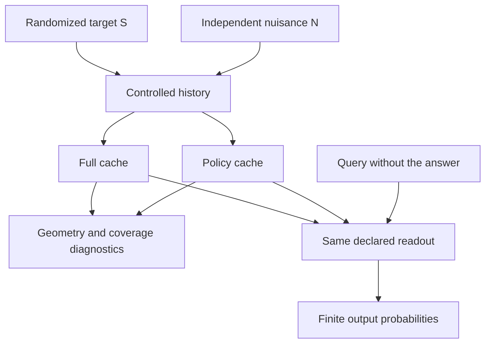

# Meeting 5: independent review and research execution plan

Prepared 13 October 2026. Review target: `whyeventry0103/kv-caching`, main at `fd77d40147932e5d23455d1dd6f2a0f773c6007d`, with the same head on the backup repository. The supplied progress report stops at `d461bb6`; the additional head commit updates status documentation.

This is a research and implementation specification. It does not promise conference acceptance, authorize additional GPU expenditure, or turn an unmeasured explanation into a finding. Existing approvals remain in force. New campaigns below must be made executable, tested on CPU, and costed before requesting one concrete compute decision.

## 1. Recommendation

Pursue **task-relevant information and the model's ability to use it**, while retaining the existing forward/reverse comparison as an evaluation result. Do not make the paper depend on Random universally beating StreamingLLM, or on an MI estimator producing a desired ordering.

The candidate scientific question is:

> Under matched cache capacity and prompt protection, when do attention and representation perturbations misrank answer accuracy, and can controlled measurements of task information and its accessibility explain those failures?

Three evidence layers are needed:

1. **Phenomenon:** reproduce the accuracy/proxy mismatch on matched examples, under matched protection, and beyond the original dataset.
2. **Explanation:** measure a precisely defined information channel with known random variables, then intervene on task-relevant versus irrelevant retained content at equal capacity.
3. **External validity:** show which part of the controlled explanation predicts or changes behavior on natural reasoning problems and a second model. Report failures and boundaries.

A generic plot of estimated `I(full cache; compressed cache)` against accuracy would not complete layer 2. A synthetic mechanism with no connection to the natural-data mismatch would not complete layer 3.

## 2. What I independently verified

| Item | Independent check | Conclusion |
|---|---|---|
| Published revision | Read main on both repositories | Both point to `fd77d40147932e5d23455d1dd6f2a0f773c6007d` |
| Changes since the previous reviewed revision | Compared `8e1e81a` to the current head; retrieved the 34 changed files and checked their Git blob identities | Reviewed the actual published changes, including `9d69b86`, approvals, the new omega table, and the latest status update |
| Protected H2O attention backend | Inspected both runner adapters and ran their tests | Both now route the protected family through its base policy's eager-attention requirement |
| Smoke admission | Inspected `smoke_record_ok`, `verify_smoke`, scheduler gate integration, and adapter tests | Empty/failed markers are refused; a PASS must match the configured identity and cover the requested family/model/budget/interval |
| Targeted tests | Ran `test_protected_selectors.py`, `test_gates.py`, `test_protocol_audit_cli.py`, `test_protocol_audit.py`, and `test_datasets.py` | **82 passed, 2 skipped**. The skipped tests require torch/kvpress, unavailable in this review environment |
| Runner preparation | Dry-ran the smoke, protected grid, and protected readout commands; checked the reverse-reader interface | CPU preparation works; the reverse reader supports budget 1024 |
| New matched omega result | Recomputed all three contrasts from the committed capture and matched-accuracy TSVs using the committed estimator | Exact match to `matched_omega_b256.json`, including the adjusted intervals and classifications; both input hashes match |
| Existing numerical reports | Compared the five updated reports with the previous reviewed snapshot | **6,063 common numeric fields, zero changed values, no added numeric fields** under a recursive numeric-field comparison. This count includes numeric metadata; it is not a count of independent observations |
| Mixed source commits in B=1024 | Compared `1123ad0` to `dbdf831` against the protected-generation source list | No file in the registered `pp` generation-source list changed. This supports the implementation-equivalence claim; it does not independently inspect the server's 796 rows |
| Citation correction | Read the other paper's Table 10 caption directly | It compares end-to-end budget 2048 with fixed-trace budget 256; that table is not a matched-budget residual [S5] |
| GSM8K preparation | Inspected `configs/benchmarks.yaml` | The approved exact revision is committed. Server download completion is reported, not independently observed |

I did **not** access the live GPU host, rerun the 7B model, verify GPU utilization, inspect the 177 server refusals, or reproduce the reported full server suite. Those remain Claude's reported observations. The real protected-selector smoke marker and its row-level records are absent from the GitHub tree I inspected. Its reported numerical PASS therefore remains **not independently reproducible from the repository**.

This review closes the two previously identified runner blockers at the code/test level. It does not justify “everything is proved correct.” No newly observed issue here requires regenerating the existing scientific results.

## 3. Bounded closeout before expansion

Complete these once; do not reopen the whole historical review without a concrete counterexample.

### 3.1 Publish the evidence already produced

Commit a compact, immutable review bundle under `results/diag/paper_audit/wp4_smoke/` containing the actual PASS JSON, its records, config and input identities, software versions, start/end times, allocated GPU time, and reproduction/validation command. Include a validator that checks the bundle against the committed specification without a GPU. Keep raw traces on the server when necessary, with hashes and retrieval instructions.

There is a concrete smoke-design discrepancy to resolve: the approval proposal describes **21 records**, including free generation for all three prompt-length cases. The current runner executes **9 replay records + 3 identity records + 3 free generations on the median-prompt case = 15 records**. The report is compatible with the smaller run, but the proposal is not. Reconcile it explicitly. Prefer covering the six omitted short-/long-prompt free-generation cases within the remaining P2 allowance, provided an execution bound fits the cap. If updating the runner changes its gate identity, rerun the complete inexpensive smoke under that one identity; do not concatenate incompatible records into a PASS. Record the existing run faithfully; do not rewrite it as 21 cases. If a scientifically justified amendment is preferred, date it and explain the reduced coverage before relying on the gate for a campaign.

### 3.2 Enforce compute caps before launch

`PROPOSALS_FOR_APPROVAL.md` explicitly states that the scheduler does not enforce GPU-hour caps; Claude checks usage after each window. That is insufficient for unattended bounded approval. The current timer limits the nightly window, not total P1/P2/P3 expenditure. For example, a single GPU can consume almost nine hours in a night, exceeding the entire six-GPU-hour P3 allowance before a morning review.

Implement a small persisted campaign ledger, separate from scientific result rows:

- Campaign identifiers `P1`, `P2`, `P3`, with cumulative limits 20, 2, and 6 allocated GPU-hours respectively.
- Charge model loading, execution, failed attempts, and retries. Sum across all allocated GPUs. CPU postprocessing is separate.
- Before launching, atomically reserve time from the shared campaign allowance, accounting for other active shards. Use a lock and unique launch IDs.
- Bound each process by the smaller of the time to the nightly stop and its reserved allowance. Reserve termination grace time as well; a two-minute kill grace must not create an unaccounted overrun.
- On exit, settle actual elapsed allocated time and release unused reservation. On an uncertain crash, retain the reservation until reconciled instead of treating it as free credit.
- Refuse and name the remaining deficit when no allowance remains. Resuming does not reset expenditure.
- Add tests for concurrent reservations, restart, a failed launch, charging two GPUs, and the combined three-stage P3 cap. These are necessary operational tests, not a new experiment-validity campaign.

### 3.3 Finish the already approved B=1024 endpoint

Keep the 24/28 GB job-specific VRAM checks, 30 GiB shared-filesystem floor, 72 GiB combined project allocation, and one-GiB project margin. Do not solve shared resource contention by lowering safeguards or deleting unrelated data.

Complete `grid-pp1024`, then forward and reverse readout within their approvals. Run:

```bash
python scripts/report_s.py protection --budget 1024
python scripts/report_s.py consequence
python scripts/report_protocol_audit.py decision --budget 1024
python scripts/report_protocol_audit.py reverse --budget 1024
```

Supply the normal runs-root/output arguments supported by each command. Read only validated FINAL results. Publish the sufficient-statistic tables, population coverage, undefined-readout counts, paired estimates, and their support. Keep missing-outcome bounds separate from sampling intervals.

The proposal specifies Holm adjustment across the two policy-specific B=1024 interactions. The inspected reverse-reader/metric implementation currently reports the ordinary intervals, without an explicit Holm inference block. Add the registered family-level test output before making a confirmatory significance claim. Record a prospective inference clarification: compute one interaction per problem by averaging its eligible seed-level interactions, use a two-sided one-sample t test of these problem-level contrasts, and apply Holm across the two policies. Report the t test as an approximate population-mean test, its N and standard error, and the existing bootstrap CIs as descriptive intervals. A zero/undefined standard error must produce an explicit non-testable status rather than an invented p-value. This does not repair selection from undefined readouts: the estimand remains the declared common-support population, with the existing bounds alongside it. Freeze this procedure before inspecting the new endpoint. Do not present an unadjusted interval as a Holm-adjusted result.

Reconcile the Qwen hold wording: the queue currently says to lift after B=1024 grid and forward readout; the progress report's next-step section says after all B=1024 analyses. My recommendation is to preserve priority until the approved reverse read and analysis are finished, then resume the already approved Qwen work. Record that ordering explicitly instead of letting a prose discrepancy decide GPU allocation.

### 3.4 Refresh the current status, not the historical record

The top execution-status table, claim ledger, and proposal headings still contain superseded “approval pending” or old progress wording. Update their current-state sections while retaining dated history. Keep Qwen3's bank gate FAIL, the exploratory exception, and the outstanding human scoring review visible.

Revise explanatory comments that overinterpret the latent basis: a displacement outside a finite PCA subspace does **not** prove the model entered an impossible reasoning state. This changes interpretation, not stored measurements.

## 4. What the current mismatch actually establishes

For the matched **25 problems × four seeds**, unprotected Qwen-7B at B=256:

| Contrast | Accuracy difference | Family-adjusted interval | Current reading |
|---|---:|---:|---|
| Random − H2O-style | +0.190 | [+0.040, +0.340] | Scoped accuracy advantage alongside larger M, Δ, and omega |
| Random − StreamingLLM | +0.120 | [0.000, +0.240] | Advantage not established after the existing adjustment |
| Random − R-KV | 0.000 | [−0.140, +0.140] | Same point estimate; equivalence not established |

The omega differences are +0.299851, +0.199977, and +0.120336 respectively. Their adjusted intervals exclude zero. The strongest joint mismatch is consequently **Random versus H2O-style**. Keep Random–StreamingLLM as a prespecified replication question, not a proven mechanism.

Use the actual definitions:

\[
M=1-\sum_{j\in S}a_F(j),\qquad
\Delta=\operatorname{TV}\!\left(a_C,\frac{a_F|_S}{\sum_{j\in S}a_F(j)}\right),\qquad
\omega=\frac{\|d_\perp\|}{\|d_\parallel\|}.
\]

Here S is retained support; d is the whitened hidden-state displacement relative to a frozen full-cache basis. Omega is a ratio, not a fraction constrained to [0,1]. Report both component norms and exclusions for zero denominators. Larger omega need not mean larger total displacement or more answer-relevant damage. Delta need not isolate query drift if retained keys also differ after earlier compressed computation.

These capture quantities are measured on held traces. Free-running accuracy is measured on independently generated trajectories. Pairing problem/seed keys makes the comparison meaningful but does not turn the two measurements into the same execution path or a causal mediation analysis.

The fork-precision FAIL constrains the existing next-token TV instrument. It does not invalidate discrete answer accuracy, but neither should it be silently imported as a PASS for new information measurements. Each new numerical channel needs its own relevant control.

## 5. Novelty: the scope must change before large new runs

| Primary source | Existing contribution relevant here | Consequence for our plan |
|---|---|---|
| CapKV, ICML 2026 [S1] | Linear-Gaussian query-to-output MI objective; practical capacity proxies and an eviction method | “First information-theoretic view of KV eviction” is unavailable. Include its capacity proxies as diagnostic comparators, with their assumptions |
| Coverage-driven KV eviction / K-VEC [S2] | Coverage and an information-theoretic motivation across heads/layers | Token coverage alone is not a new explanation. Do not treat its simplifying bound as measured task information |
| InfoKV [S3] | Entropy-related token importance for long reasoning | Entropy-weighted attention is already explored. Its abstract was verified; a method-level reproduction requires the full paper and code |
| Random Attention [S4] | Matched prompt protection, random eviction, and controlled redundancy/retrieval probes | Neither random-beats-scoring nor a planted-fact demonstration is enough for our novelty claim |
| Does Accuracy Equal Evidence? [S5] | Accuracy versus evidence under fixed-trace compression | Distinguish our matched protocol and proposed information channel from its faithfulness evaluation |
| Usable information and conditional probing [S6–S7] | Predictability depends on the decoder family; a representation can make information easier to use | Credit this distinction; our contribution must be the cache-specific test and evidence |

The old provisional novelty PASS applies to its earlier measurement proposal. It does not automatically carry over to Meeting 5. Update `RELATED_WORK_MATRIX.md` with exact overlapping experiments and the incremental claim before launching the new campaign.

The promising incremental claim is **a validated way to distinguish global retention, task-specific information, and decoder access, together with interventions and held-out prediction showing which explains proxy failures**. This is a candidate, not an established novelty theorem. If the controlled test only reproduces known redundancy or prompt-protection effects, keep it as corroboration and lead with the distinct forward/reverse measurement result if that survives.

## 6. The information-theory model to use

### 6.1 Define the variables before choosing an estimator

- X: a specified history or experimental input, drawn from a specified distribution.
- C_F: full cache at a specified point.
- C_pi: the complete persistent cache state under policy pi, including retained positions and relevant auxiliary state.
- Y: a task target; S: an experimentally randomized task-relevant fact; N: randomized nuisance information.
- U: template, query specification, positions, and other controlled context. For an experiment about S, U must not reveal S.
- R: independent eviction randomness, recorded separately from generation randomness.
- Z: a finite observable output of a specified readout channel.

At an instantaneous common-history crop, C_pi = T_pi(C_F,R), so conditioning on R gives the usual processing relation. After different free-running histories, the compressed cache is not generally a subset of the full model's cache at the same token count. Do not apply a subset argument across those trajectories.

### 6.2 Why raw cache-to-cache MI is the wrong primary endpoint

For finite-precision deterministic compression at a common history and fixed seed:

\[
I(C_F;C_\pi\mid R)=H(C_\pi\mid R).
\]

This rewards any retained variability, including irrelevant content. In idealized continuous deterministic settings, MI can also become singular or infinite. Flattening millions of activations and treating their coordinates or tokens as independent observations does not solve that problem.

A concrete discrete counterexample: Y is one fair bit and N is an independent four-valued nuisance. A one-slot cache retaining Y shares one bit with the full input and permits perfect prediction. A one-slot cache retaining N shares two bits but leaves Y at chance. Scaling N's vector representation arbitrarily can also make losing N dominate a geometric distance without changing task accuracy. This is a mathematical possibility, not a proof that Random behaves this way on MATH.

### 6.3 Avoid the deterministic-question trap

For a deterministic benchmark with exact answer Y=f(Q), Shannon `I(Y; cache | complete question Q)` is zero because `H(Y|Q)=0`. An unbounded observer already knows the answer from Q. It is therefore unsuitable as a nonzero measure of what a reasoning model computed.

Two valid alternatives are:

1. Randomize a fact S independently of a query template U, with S absent from U. Study the channel carrying S through the cache to a declared readout.
2. Specify a restricted decoder family and evaluate held-out log loss, with and without a representation. Call this decoder-accessible information or a conditional probing estimate, with its optimization and generalization limits. It is not unrestricted conditional Shannon MI [S6–S7].

### 6.4 Separate preservation from use

For a specified population, Bayes-optimal log loss from cache C is `H(Y|C,U)`. A fixed model readout q has risk:

\[
\mathbb E[-\log_2 q(Y\mid C,U)]
=H(Y\mid C,U)
+\mathbb E\,D_{KL,2}\!\left(p(Y\mid C,U)\Vert q(Y\mid C,U)\right).
\]

The first term describes uncertainty left after observing C. The second describes how the particular reader fails to exploit the available conditional distribution. This identity motivates competing explanations. We do not know the true high-dimensional conditional distribution, so we cannot claim to have separately measured the two terms simply by fitting a probe.

Higher task MI also does not guarantee higher accuracy for every fixed decoder. An invertible permutation of four answer labels transmits two bits perfectly while getting every label wrong. The finite-channel reference checks for this plan reproduce that case. Report information, log loss, and accuracy together.

### 6.5 Estimators to avoid as the headline

Do not start with MINE, a high-dimensional nearest-neighbor MI estimate, summed per-token MI, or a correlation of four policy averages. Distribution-free high-confidence MI lower bounds have severe finite-sample limits; these are not solved by changing the optimizer [S8]. Strong assumptions can make an estimator useful, but must be explicit and tested.

KL or TV between next-token distributions measures a discrepancy. Jensen–Shannon divergence has an MI interpretation for a mixture's arm identity and sampled output; it does not automatically measure task information retained by a cache.

## 7. Prespecified hypotheses and failure outcomes

| Question | Testable prediction | Finding that weakens or rejects the proposed explanation |
|---|---|---|
| Is the mismatch a prompt-loss effect? | Policy differences change under identical prompt protection and capacity | Most relevant differences vanish; report protection as the explanation rather than inventing a deeper MI mechanism |
| Does useful retained content explain a residual mismatch? | An early task-information measurement predicts later performance beyond M/Delta/omega, occupancy, and exposure | It adds no held-out predictive value, or only tracks the final answer already produced |
| Does target information matter causally? | Protecting target content beats equally sized nuisance protection; the relevant contrast changes when the task changes | Nuisance protection helps equally, or the effect is explained by a changed cache size, timing, or numerical artifact |
| Is the limitation accessibility? | A fixed-capacity probe decodes a fact where the native reader fails; a controlled readout change changes success | The probe memorizes template/answer identities, fails held-out templates, or lacks incremental signal |
| Is legacy Random representative? | Fresh-uniform behavior agrees in the prespecified comparison, or the difference is quantified | Only the fixed-slot implementation has the advantage; narrow the claim to that algorithm |
| Does it generalize? | The prespecified contrast or its explanatory relation survives new tasks/model tests | It reverses or disappears; report a boundary and avoid a universal Random claim |

All directions and practical thresholds must be dated before the new outcome reads. Do not choose the best policy pair, layer, checkpoint, information metric, or dataset after seeing which supports the narrative.

## 8. Work package M5-A: complete matched prompt protection

### 8.1 First experiment: the missing policies

Start on the existing Qwen-7B/MATH-500 discovery cohort, B=256, four historical generation seeds. Reuse validated existing rows for Random and StreamingLLM. Add **H2O-style protected and R-KV protected free runs**, 400 each. A 400-row fresh-uniform protected arm is a separate implementation-sensitivity experiment. This makes the immediate priority 800 essential new accuracy rows, or 1,200 including fresh-uniform, before adding all forward/reverse readouts.

Do not approve the old 74–142 GPU-hour WP5 wholesale: it includes a different stage mix and omits protected R-KV. Replace it with a Meeting 5 manifest and a measured cost estimate. Preserve the original manifest as history.

The historical Random is a fixed-slot, repeatedly reseeded algorithm. Keep its name qualified in methods and figures. Fresh uniform is a different versioned policy, not a silent repair of past runs. Likewise use **H2O-style/current-attention** for the current implementation; it is not canonical accumulated-attention H2O.

### 8.2 Prompt protection and capacity

For P prompt entries, nominal budget B, and minimum 64 trace slots, historical protection uses `B_eff=max(B,P+64)`. Three original problems relax B=256. A protection effect cannot be cleanly attributed to protection if only one arm receives extra capacity.

- Primary fixed-B comparison: the prompt-defined cohort with `P+64<=B`, frozen before examining new outcomes. Reuse the 97 fitting historical problems where appropriate.
- Prospective whole-cohort comparison: use the **same B_eff for every policy and both protection conditions for each problem**. Report the effective-budget distribution and how much trace space remains.
- To complete a capacity-matched whole-cohort historical comparison, add only the missing relaxed-budget unprotected comparator rows after the manifest inventory. At most four policies × three problems × four seeds = 48 rows for that specific cohort, subject to checking whether any already exist.
- Report actual K/V bytes, peak occupancy between pruning events, prune count, compression interval, first eviction, prompt retention, recency allocation, completion/truncation, and token count. Equality of nominal B is not enough.
- The unprotected condition means prompt tokens are **eligible for eviction**, not that every prompt token is forcibly removed.

### 8.3 Protected R-KV implementation

Create a new versioned adapter, for example `src/kvcache/presses/rkv_prompt_protect.py`; leave the already measured R-KV scorer unchanged.

At every layer/KV-head prune:

1. Track absolute positions, preserving the existing RoPE and retained-order contracts.
2. Compute the published-port R-KV scores with its existing lambda, similarity, pooling, and query-recomputation settings.
3. Form the mandatory union of prompt positions and R-KV's recent **eight** entries. Count overlaps once.
4. Let target be the effective budget; fill remaining slots from eligible positions using the same base score and an explicitly defined tie rule.
5. Gather both K and V with the same indices; preserve the scorer's required ordering and recent-window semantics. Do not assume chronological resorting is harmless to a redundancy implementation whose “last similar” operation depends on ordering.
6. Log retained absolute positions compactly at smoke time and retention summaries during campaigns.

Do not implement this by merely adding `rkv` to the three-family registry. R-KV has an intrinsic window, scorer semantics, and source dependencies that the current H2O/uniform adapter does not encode.

With prompt protection disabled, the new path must reproduce the base policy's retained sets and behavior on the same stream, not just its final cache size. Test long prompts, overlaps, multiple layers/heads, repeated prunes, resume, tied scores, and K/V alignment. Run a bounded real-model smoke before promotion.

Give it its own generation identity, including `rkv.py`, the wrapper, relevant registry/decode files, model revision, configuration, and input manifest. Prepare changes in an isolated branch while current jobs run; deploy code used by a running identity only at a quiescent boundary.

### 8.4 Endpoints

Primary: paired free-running accuracy differences, averaged over seeds within problem and then over problems. Prespecify Random–H2O-style and Random–StreamingLLM as the two scientific pairings; include Random–R-KV descriptively or as a declared third comparison. Report protection-by-policy interactions directly:

\[
\bigl(A_{R,+P}-A_{j,+P}\bigr)-\bigl(A_{R,-P}-A_{j,-P}\bigr).
\]

Use matched keys and problem-cluster uncertainty. Do not compare overlapping separate CIs as a significance test. Do not interpret a non-significant difference as equivalence. If practical equivalence matters, freeze a margin and run an equivalence test.

On the existing capture cohort, obtain new protected M/Delta/omega measurements for the compared policies on the **same reference trace, layer/checkpoint specification, and keys**. Do not combine protected accuracy with old unprotected metrics and call that a protected mismatch.

## 9. Work package M5-B: replication across datasets

### 9.1 Dataset sequence

| Dataset | Role and preparation | Scope |
|---|---|---|
| MATH-500 | Existing 100-problem discovery cohort; reserve a hashed selection from untouched problems for confirmation | Preserve continuity; discovery is not independent confirmation |
| GSM8K | Already pinned to `740312add88f781978c0658806c59bc2815b9866`; loader exists | First new natural dataset; no generation campaign has yet been approved |
| BBH logical deduction, five objects | Recommended non-math extension with finite answer labels. Official repository has 250 examples; inspected commit `9ee07bd481feebf959a6b59d61ea57bdcf30964d`, file `bbh/logical_deduction_five_objects.json`, blob `936cd6d80db71aeacaea857c34f9af87e1c34964` | Implement a pinned loader and strict option scorer; preserve source license/canary metadata. The inspected revision is a proposal, not a claim of owner approval |
| Existing AIME-24 work | Inventory and report what can be reused | The repo already has a three-policy B=2048 design and results, so “only one dataset has ever been run” is too broad. It lacks the matched four-policy protection factorial; 30 problems also limit inference |

Use BBH as the default third task family rather than implementing several benchmark loaders at once. Two math datasets answer the immediate replication request; a non-math task makes the scope more informative. Do not call one BBH subtask a general language-understanding benchmark suite.

### 9.2 A feasible staged grid

First freeze full-cache and grader behavior on calibration examples that will not enter confirmation. Check prompt lengths, truncation, answer formats, and how often a run actually reaches eviction. Do not select a benchmark because Random won its pilot.

For each new dataset, the core prospective design is:

- One primary model: the existing pinned Qwen-7B.
- Four historical policy definitions, each with prompt protection OFF/ON, plus full cache.
- One primary budget, initially B=256 for continuity; B=1024 is a secondary regime only where compression is actually active.
- Start the **planning calculation** at 200 problems × two generation seeds; this is not a guaranteed adequate N.
- A fixed randomly selected mechanistic subset, selected by IDs before outcomes, receives expensive captures. Do not capture every token on every dataset.
- Fresh-uniform and canonical-H2O/CapKV selector comparisons are separate sensitivity/baseline extensions. The main four-policy experiment must not silently change its definitions.

At 200 × two seeds, full cache plus eight compressed arms costs **3,600 free generations per dataset per primary budget**, before extra probes. At 100 × two it is 1,800. A second compressed budget adds 3,200 at N=200 because the full-cache bank can be reused. Make these counts explicit before any approval request.

If budgets are too small for many prompts, freeze the strict-fit and adaptive-capacity analyses described above. If a task rarely reaches eviction at B=1024, report it as a low-exposure regime. Do not pad natural free runs or filter based on compressed correctness to manufacture damage.

For a tight budget, first replicate the protected four-policy contrast plus full cache on new tasks, then complete the OFF/ON factorial. That reduced stage has five conditions, 2,000 generations at 200 × two. State explicitly that it does not yet estimate each new dataset's protection effect. It is preferable to a nominally complete but severely underpowered many-cell campaign.

### 9.3 Grading and sampling controls

Freeze prompts, sampling, stop rules, token caps, model/dataset revisions, and score extraction before outcomes. Use problem-ID manifests and disjoint calibration/confirmation sets. For the new tasks, proposed maximum token caps are GSM8K 8,192 and BBH 4,096, subject to a full-cache calibration check and a pre-outcome amendment if truncation is material; do not change an arm's cap alone. Retain the established MATH cap for historical comparability.

For BBH require a single valid final option under the frozen format; handle multi-answer/ambiguous output explicitly. For GSM8K test the dataset's gold-answer parsing separately from the model's final-answer extraction. Do not introduce an LLM judge to rescue a policy after results are known.

The 42-row secondary-grader review remains a human responsibility: assign the owner/supervisor, blind policy/model where possible, preserve disagreements, and publish an ambiguity sensitivity. The frozen primary scores remain available. Qwen3 exploratory status does not disappear after that review.

### 9.4 Sample size and multiplicity

The independent sampling unit is the problem, not every seed or head. Estimate the variance of the **paired, seed-averaged endpoint** from calibration or an explicitly declared planning source.

Use `N ≈ (z * SD_pair / target_halfwidth)^2` only as a planning approximation; simulate the chosen clustered estimator and multiplicity procedure before freezing N. For orientation, at N=200, a paired SD of 0.3 gives an ordinary 95% half-width around 0.042; SD 0.5 gives about 0.069. Thus 200 problems is not automatically enough for a five-point superiority claim, let alone ±0.025 precision.

Freeze one primary contrast family per scientific question and show all prespecified pairings. Use Holm for formal tests, with descriptive paired CIs clearly labeled. For a claim that the mismatch holds across multiple datasets, report each dataset's estimate and heterogeneity; do not pool them into one p-value and claim universality. Use more independent problems before buying many additional generation seeds unless pilot variance indicates otherwise. No “run until significant” rule.

## 10. Work package M5-C: a tractable information experiment

### 10.1 Primary channel: finite randomized facts, not millions of coordinates

Use a controlled decode-path memory task with **two independent four-valued variables**, S and N. S is relevant to the primary task; N is irrelevant to that task. For each template/context block U, enumerate all 16 `(S,N)` combinations with equal probability. Variable names, layouts, and filler vary across blocks; no outcome-dependent selection.

The initial protected prompt specifies the task and allowed answer symbols but does not contain the values of S or N. Feed the fact-bearing body through the same token-by-token decode-cache path used for evicted trace tokens, rather than putting all facts inside an inviolable prefill. This is a controlled memory experiment, not a naturally generated chain of thought.

Use nonce aliases and value encodings verified to have equal token lengths for the pinned tokenizer. Use equal-length spans and counterbalance target/nuisance age positions across blocks. Screen filler for accidental value/key clues. Retain the original source trace hash when real reasoning text is used as filler. Split by complete template/filler block, never by individual `(S,N)` variants of a block.

At a fixed checkpoint, snapshot the branch cache and evaluate short **readouts that cannot evict again**. Each readout starts from an independent clone and receives no target-bearing external state. Readout 1 asks for S; readout 2 asks for N. This allows the same retained cache to be examined under different task queries. Query tokens are always retained under the same rule in all arms. Do not feed gold answer tokens before the measured output position.

The primary experiment includes full cache and the four policies, under equal capacity and protected task instructions. After the fresh-uniform sensitivity is characterized, include it as a separately named arm if feasible. Freeze one primary age regime, initially 1,024 decode-body tokens at B=256, with balanced target/nuisance positions. A later age sweep is secondary, not an opportunity to choose the most favorable distance.

The primary readout output alphabet is four allowed **single-token** answer symbols plus OTHER. Gather their probabilities from the native model distribution; OTHER contains the remaining vocabulary mass. Do not renormalize away format failures in the primary channel. A conditional-on-valid-answer view may be shown separately.

If single-token symbols cannot be made reliable under the model's template, redesign and freeze the finite parsing channel on calibration data. Do not silently pretend that a multi-token sequence probability is a normalized categorical distribution.

The measurement structure is:



Full and policy caches are built in separate branches. This diagram does not assert that a cache from a different free-running trajectory is a subset of the full cache.

### 10.2 Exact operational MI for this channel

For one context U, let `q_pi(z | s,n,u)` be the actual readout distribution over the five output categories. Marginalize the balanced nuisance variable:

\[
p_\pi(z\mid s,u)=\tfrac14\sum_n q_\pi(z\mid s,n,u),\qquad
\bar p_\pi(z\mid u)=\tfrac14\sum_s p_\pi(z\mid s,u).
\]

Then compute, in bits:

\[
I_\pi(S;Z\mid u)=\tfrac14\sum_s\sum_z p_\pi(z\mid s,u)
\log_2\frac{p_\pi(z\mid s,u)}{\bar p_\pi(z\mid u)}.
\]

This is **MI through a specified finite answer channel**, bounded between zero and two bits. It is not an estimate of all information inside C_pi. The same construction measures nuisance-query information. Enumerating the 16 input combinations and using output probabilities removes Monte Carlo output-token sampling; uncertainty remains across sampled contexts and eviction seeds.

Also report native greedy exact accuracy, expected correct-symbol probability, OTHER probability, and proper log loss over the unrenormalized answer probabilities. Compute log loss with stable log-softmax; do not clip small probabilities merely to make a table finite. Distinguish mathematical zero-probability cases in fixtures from numerical underflow. No injected numerical tolerance may be chosen after inspecting the policy ordering.

The score `2 − cross_entropy_bits` is a useful declared-reader score on the uniform target, not “the exact number of bits in the cache.” It can be negative. Differences of variational lower bounds do not bound the difference in true cache MI.

### 10.3 Mandatory reference cases

The CPU reference for this plan was checked on:

| Channel | MI | Correct probability | Interpretation |
|---|---:|---:|---|
| Identity on four values | 2 bits | 1 | Information and answer alignment |
| Uniform output independent of input | 0 bits | 0.25 | No transmitted target information |
| Fixed wrong permutation | 2 bits | 0 | High information is not correct label use |
| Always OTHER | 0 bits | 0 | Format failure does not disappear through normalization |

Implement these, plus target/nuisance independence, arbitrary category permutation invariance of MI, complete state-grid checks, invalid probabilities, and missing/duplicate variants. Use `0 log 0 = 0` only in the mathematically valid MI sum. A missing input combination is PARTIAL, not an invitation to change the prior.

### 10.4 Novelty and non-tautology controls

The novelty is not inserting a fact; that has precedent [S4]. This instrument must add a test of task-specific versus task-irrelevant transmission, a task-switch contrast on the same cache, and a bridge to proxy misranking. If the final-answer channel merely reformulates final-answer accuracy, call it a characterization, not an explanation.

For explanatory evidence, measure an **auxiliary fact readout before the final task answer exists**, then test whether it predicts a later compositional answer. A separately frozen extension uses two independent two-bit operands and a modulo-four operation, with all 16 operand pairs enumerated. Auxiliary queries test operand access; a separate free continuation computes the result. Individual operands can each have zero MI with a combined target while jointly determining it, so summed per-token relevance cannot substitute for joint information.

A compositional probe is also not automatically novel. Its useful increment must be the link between a measured earlier information channel, a later held-out outcome, and an intervention that changes the relevant relationship. If that link fails, do not relabel retrieval accuracy as mechanism discovery.

### 10.5 Calibration, confirmation, and scale

Build the CPU generator and reader first. Proposed first real-model calibration: four context blocks × 16 value combinations × five cache conditions = **320 prefix executions**, plus short readouts. Give this a separate proposed cap, initially four GPU-hours, and stop at the cap if throughput is lower than expected. This is new work, not covered by P2/P3. Pilot records are excluded from confirmatory claims.

Calibration checks whether full-cache readout works, end-to-end and cloned readouts agree, the task is not at floor/ceiling in every arm, eviction actually occurs, and OTHER is understood. A low-dynamic-range probe must be redesigned using calibration only; it cannot support a confirmatory explanation.

After timing and variance measurement, plan a fixed confirmation set with a target of 0.1-bit half-width for a prespecified paired channel contrast and a separately chosen practical accuracy effect. Sixty-four independent context blocks is a **starting costing scenario**, not a power guarantee: `64×16×5=5,120` prefix executions for one regime. Increasing seeds, models, regimes, or interventions multiplies this count. Keep a held-out set of template/filler families. Freeze final N after the pilot, before looking at confirmation outcomes.

## 11. Work package M5-D: interventions and the bridge to real reasoning

### 11.1 Intervene at the same budget

Within each controlled context, compare:

1. The ordinary policy.
2. Target-span protection: prevent the relevant span from being evicted, filling the same remaining budget with the base policy.
3. Equal-length nuisance-span protection.
4. A prespecified placebo span matched for length and age, where needed to distinguish position from content.

Keep K/V bytes, protected instruction tokens, intrinsic recent window, pruning schedule, query/readout, and sampling settings equal. Use predeclared target/nuisance positions and counterbalanced ages. Log whether an intervention changed retention; an already retained span is a real zero-dose case, not a failure to discard.

Prefer preventing eviction to restoring a padded bundle after the fact: it avoids the old prompt-plus-padding interpretation problem. If restoration is used, stash the actual pre-eviction K and V at every layer/head, preserve absolute positions, replace an exactly equal number of entries, and distinguish full-cache-source restoration from compressed-history-source restoration. Test both key and value mutations and the effects of continued eviction. Never silently compare different cache sizes or stop eviction in just one arm.

The primary intervention contrast is target protection minus nuisance protection on both log score and later accuracy. A task switch asks whether the effect follows the task rather than merely benefiting all outputs. These experiments identify effects of the specified cache interventions. They do not by themselves prove that a measured MI scalar is the sole causal mediator.

### 11.2 Add the inexpensive competing predictors

At prespecified checkpoints collect:

- M, Delta, omega and both omega norms, using the existing validated definitions.
- Retained prompt fraction, age distribution, unique absolute-position coverage, cross-head overlap, prune/exposure counts, effective K/V bytes, and generated length.
- CapKV's declared capacity proxies, calculated stably on K, V/output directions as specified by that source [S1]. Keep them labeled **surrogate capacity**, with dimensions, normalization, assumed query/noise covariance, and layer aggregation recorded. Do not call a log determinant measured task MI.
- Target/nuisance channel scores and auxiliary fact-access scores where the task supports them.

Compute log determinants on small Gram matrices with stable factorizations; record any regularization as part of the measurement. Report sensitivity to predeclared scaling because capacity proxies are scale-dependent. Do not fit a whitening transform or select a layer using the test policy's accuracy. Avoid materializing full attention matrices or saving every cache.

### 11.3 Optional representation probes, only if they resolve an ambiguity

If native readout fails but the distinction between lost information and inaccessible information matters, save fixed-size **pre-answer query representations** at predeclared layers. Start with a linear/ridge multinomial decoder and a frozen low-dimensional projection fitted on calibration full-cache data. Use the same training budget and feature dimension across policies, and a shared decoder as the primary operational comparison. A separately fitted per-policy decoder is a sensitivity to decoder adaptation, not the same estimand.

Split by whole problem/template families, not tokens or seeds. Exclude the correct answer, final correctness, future trace tokens, and outcome-selected checkpoints from the representation or its baseline. Validate on shuffled labels and unseen aliases/templates. Report learning curves and negative held-out decoder gains. A powerful probe's success shows decodability for that family; it does not prove that the model uses the feature.

Do not train a giant contrastive critic on the 25 capture problems. Keep learned probes optional until a simpler controlled channel has demonstrated useful dynamic range.

### 11.4 Natural-data bridge

Start with the new finite-label BBH task and a programmatically verified subset of mathematical problems. Define a small set of intermediate facts or constraints independently of model policy and final outcome. Verification must be deterministic where possible; use human review for ambiguous natural facts. Do not let an LLM invent unverified ground-truth reasoning steps.

Use checkpoint-only features to predict later free-run correctness on held-out problems. Compare prespecified models:

- baseline: problem/calibration difficulty, prompt length, full-cache trace length, budget, and exposure;
- baseline plus M/Delta/omega;
- baseline plus information/access features;
- baseline plus both.

Evaluate held-out proper log loss and calibration first; accuracy/AUC may be secondary. Fit preprocessing inside training folds. Split all policies and seeds of a problem together. Test transfer by holding out a dataset or model when enough data exists. Do not train/test on four aggregate policy means.

A within-problem paired contrast is useful for controlling difficulty; a predictive model must not use future correctness or a post-outcome “hard-example” selection as an input. Report associations as associations. For a causal natural-data bridge, repeat a predeclared target-versus-placebo retention intervention on a separately verified subset. If that subset is small or highly selected, restrict the mechanism claim accordingly.

## 12. Implementation map for Claude Code

Reuse the repository's validation, provenance, and problem-cluster estimation boundary. Add versioned modules instead of modifying completed generation definitions in place.

| Proposed component | Responsibility | Acceptance evidence |
|---|---|---|
| `docs/protocol/MEETING5_INFORMATION_PROTOCOL.md` | Variables, distributions, hypotheses, endpoints, cohorts, exclusions, precision goals, decision rules | Dated before new outcome reads; clear discovery/calibration/confirmation distinction |
| `configs/meeting5/*.yaml` and hashed manifests | Exact expected problem/seed/policy/protection/budget/state combinations | Coverage derived from configs, never observed rows |
| `src/kvcache/presses/rkv_prompt_protect.py` | New protected R-KV path | P=0 base parity; equal-budget protection; multi-prune K/V and position tests; bounded real smoke |
| `src/kvcache/task_information.py` | Finite channels, target/nuisance marginalization, bits, log scores, OTHER, contrasts | Analytic reference channels and real reader fixtures |
| `src/kvcache/information_tasks.py` | Counterbalanced fact and compositional-task generation | Exact class balance, constant lengths, no answer leakage, stable IDs |
| `scripts/run_information_probe.py` | Decode-path cache construction, independent cloned readouts, compact capture | Full/full identity, baseline probability agreement, no shared mutable cache, resume equivalence |
| `scripts/report_information_probe.py` | Strict validation, problem/context-cluster inference, exclusions and tables | FINAL/PARTIAL/INVALID through the real CLI; no verdict on incomplete data |
| `scripts/report_policy_replication.py` | Natural-data accuracy and protection interaction | Equal-problem paired computation, matched capacity, multiplicity, all planned contrasts |
| `scripts/report_information_bridge.py` | Optional held-out prediction and intervention analysis | Grouped splits, training-only preprocessing, leakage controls |
| `scripts/plan_meeting5_cost.py` | Row counts, measured rate ranges, storage, reservations | Counts match manifests; combined-stage/campaign cost includes retries and loading |
| `src/kvcache/campaign_budget.py` or equivalent | Persistent cumulative GPU allowance | Restart/concurrency/time-bound tests; fail before overspending |

Each row should include a schema version, design ID, model/tokenizer/data revisions, generation implementation ID, input hashes, context/problem ID, random-variable assignment, generation and eviction seeds, policy version, protection rule, nominal/effective budget, position/checkpoint, task/query identity, expected alphabet, probabilities/log probabilities, valid numerical controls, truncation/exclusion reason, timestamps, GPU allocation, and run identity.

Include the grader and analysis-code hashes in analysis provenance. Store counts, shapes, finite/domain checks, probability sums, and the expected state-grid specification. Undefined or ineligible cases need a reproducible reason. Do not coerce strings to booleans or drop holes and change denominators.

Postprocessing retires stale outputs before work, fingerprints every consumed dependency, writes atomically, and produces a figure only from a FINAL validated read. An invalid row makes invalid evidence; a scientifically null result is a completed valid analysis. No “best so far” figure should quietly become the final paper figure.

## 13. Compute, storage, and scheduling

**Approved work now:** finish the original protected B=1024 forward work; P1/P2/P3 within their separate total limits and normal 01:45–10:43 Dubai windows. The protected-selector smoke has reportedly used about 0.3 GPU-hours; verify that figure in the actual launch ledger. Already approved Qwen work retains its exploratory gate exception and priority hold.

**Not approved by this review:** the revised M5 campaigns, new R-KV smoke, information pilot, new-dataset generation, unprotected B=1024 reverse, or a large WP6 expansion. Prepare them fully on CPU and request one itemized budget after measurements, rather than asking repeated abstract questions.

Budget formula:

\[
T_{GPU}=\sum_{cells} N_{problem}N_{seed}N_{condition}\,t_{cell}/3600
+T_{load}+T_{retry}+T_{instrument}.
\]

Use the relevant **source trace** to price replay. Use measured protected R-KV and information-run timings, not the old H2O rate. Give lower/upper estimates and a hard stop separately. The nominal maximum nightly capacity is `2×8h58m ≈17.93 allocated GPU-hours`; resource sharing can make actual capacity much smaller. A 100-hour campaign cannot honestly be promised as six calendar nights.

Record at least the next planning scenarios:

| Scenario | Incremental condition count | Decision |
|---|---:|---|
| Close protected H2O/R-KV discovery accuracy | 800; plus any explicitly missing capacity-matched comparators | Highest-priority new natural-data campaign after smoke/costing |
| Fresh-uniform protected sensitivity | 400 | Keep separately named; valuable against the fixed-slot objection |
| One new dataset, protected-only replication at 200×2 | 2,000 free generations | Lower-cost first stage if the full factorial is unaffordable |
| One new dataset, full four-policy protection factorial at 200×2 | 3,600 free generations | Completes the professor's within-dataset protection question |
| Controlled channel calibration | 320 prefix executions plus short readouts | Proposed small capped pilot, not a paper result |
| Controlled channel costing scenario | 5,120 prefix executions for 64 blocks, one regime, five conditions | Freeze N only after measured variance/cost |

Stream K/V-derived summaries and a limited feature set. Preserve raw generated text and token IDs where needed for reproducibility, but do not save all caches/attention tensors. Count output bytes before launch and reserve space for concurrent shards. Keep published compact sufficient statistics and input manifests small enough to commit.

If shared-disk contention recurs, prepare a concise usage/blocker report for the owner to take to the administrator. A separate volume or agreed quota is preferable to repeatedly losing windows. Do not contact others or alter shared files without authorization.

## 14. Paper structure and figures

Working title, pending evidence: **What Does KV Eviction Preserve? Task Information, Readout, and Reasoning Accuracy**.

1. **Introduction:** the concrete evaluation problem: familiar perturbation diagnostics can disagree with task performance. State the scoped observation and the distinction the paper tests.
2. **Definitions and protocol:** cache capacity, prompt protection, algorithm versions, fixed versus free traces, M/Delta/omega, finite information channels, and estimation units.
3. **Observed mismatch and replication:** show matched examples and all policy pairs; separate discovery from confirmation.
4. **Prompt and budget control:** the full protection comparison, including long-prompt capacity handling. This may explain much of the phenomenon; do not bury that result.
5. **Information and access experiments:** the explicitly defined channel, its controls, competing capacity/coverage metrics, and intervention results.
6. **Natural-data bridge and limits:** out-of-sample predictions, scoped interventions, a second model, counterexamples, and known numerical/grading restrictions.
7. **Practical evaluation recommendation:** when a cheap proxy is informative, when answer validation is needed, and what the proposed diagnostic adds. Do not advertise a deployment selector unless one is actually built and tested.

Use six principal figures, drawn from versioned data by standard plotting tools:

- **Figure 1:** matched accuracy versus M/Delta/omega with paired intervals, not decorative arrows between incomparable averages.
- **Figure 2:** OFF/ON prompt protection for all four policies; show effective trace capacity and the strict-fit sensitivity.
- **Figure 3:** protocol diagram distinguishing the full cache, compressed cache, randomized target/nuisance variables, and the finite readout channel. State exactly what is observed.
- **Figure 4:** target versus nuisance information/log score at matched budget, with full-cache controls, OTHER mass, and all prespecified policy contrasts.
- **Figure 5:** target/nuisance/placebo intervention effects and task-switch or compositional prediction, with paired context intervals.
- **Figure 6:** held-out prediction or transfer; show failures and uncertainty. Put forward/reverse results prominently if they remain the main distinct contribution.

Use consistent colors for policies, identical axes where comparable, readable legends, visible sample sizes/exclusions, and vector PDF/SVG output. A caption must say whether a metric is teacher-forced, free-running, calibrated, or exploratory. Put toy diagrams and actual experimental plots in separate visual styles. Never fabricate a diagram that looks like measured data.

The abstract is written last. It should have one question, a concise controlled design, the strongest supported findings with scope, and the practical implication. “Most residual was prompt loss,” “omega proves damage,” “MI proves Random is better,” and “all gates pass” remain disallowed without the evidence those statements would require.

## 15. Decision gates and a finite work sequence

| Gate | Required evidence | Proceed / stop rule |
|---|---|---|
| G0: reproducible execution | Smoke bundle, reconciled smoke scope, cap enforcement, unchanged historical numbers | Close the implementation review once these pass |
| G1: protected phenomenon | Complete four-policy matched accuracy/capture read | If mismatch vanishes, lead with the protection/protocol result; do not force an information explanation of a vanished effect |
| G2: information instrument | Calibration validity, finite-channel reference tests, full/full identity, no leakage | If no usable dynamic range, redesign on calibration once or abandon this instrument |
| G3: explanatory increment | Earlier information/access signal adds held-out value beyond simpler predictors and at least one targeted intervention supports the account | If absent, retain descriptive diagnostics; no mechanistic headline |
| G4: transfer | New datasets and a feasible second-model check with explicit scope | A failure narrows the claim; it is not grounds to remove the condition |
| G5: paper readiness | A distinct contribution relative to closest work, auditable figures/tables, adequate uncertainty, artifact commands, scoped limitations | Choose the venue when this evidence is credible; do not inflate conclusions to meet a deadline |

Practical sequence:

1. **Now, CPU:** finish the bounded closeout, update the source matrix, freeze the Meeting 5 protocol draft, implement protected R-KV and finite-channel tests, create held configs and cost manifests.
2. **Next available approved windows:** complete B=1024, reconcile/complete P2, run P3 within its cap; publish FINAL analyses and actual timings. No old B=256 rerun is implied.
3. **One concrete budget request:** revised 800-row protected comparison, fresh-uniform sensitivity, and a bounded new information calibration. Present exact counts, prerequisites, worst-case allocated time, and storage.
4. **After calibration:** freeze the first new dataset cohort and the information confirmation N. Run the smallest design that can answer each selected primary endpoint. New approvals should correspond to this frozen design, not an open-ended research budget.
5. **After the first mechanism read:** either add the natural-data bridge/second model or narrow the paper. Do not buy the old 600–1,100-hour WP6 just because it was listed in an earlier plan.
6. **Evidence freeze:** lock the manuscript's claim ledger, generate every number/figure, run the relevant bounded acceptance suite and artifact reproduction, and obtain a skeptical human read of novelty and causal wording.

The ICML 2027 submission deadline was not verified from an available official dates page in this review. Use milestone-based scheduling now and confirm the official call before promising a submission date. A strong measurement/mechanism paper is a plausible direction, not a guaranteed A* acceptance route.

## 16. Decisions on Claude's current questions

| Question | Recommendation |
|---|---|
| Add unprotected B=1024 reverse now? | **Defer.** Finish the approved protected interaction first. Add the unprotected arm only if the final paper needs a protection-by-direction interaction at that budget; it is not necessary for Meeting 5's first mechanism test |
| Approve old WP5 now? | **Rescope, then approve a measured budget.** Protected R-KV is essential to Meeting 5 and absent from old WP5. Prioritize the missing accuracy arms before every replay extension |
| What should WP6 confirm? | First confirm the matched policy/protection phenomenon on new tasks; then the explanatory relation. Do not default to the most expensive ±0.025 forward/reverse endpoint |
| Who fills the human grading sheet? | Owner/supervisor or a designated human reviewer. Claude can prepare blind material and record decisions, not impersonate human adjudication |
| Shared disk? | Prepare evidence for the owner to discuss with the administrator; keep current safety thresholds |
| Does MI suffice for an A* paper? | **No metric alone suffices.** The opportunity is a novel, falsifiable explanation with interventions, replication, and a useful measurement protocol |

## 17. Claude Code handoff

Give Claude this document and the following instruction:

> Continue from the actual repository head, preserving the existing experiments and approvals. Implement the Meeting 5 plan in this document. The scientific objective is to test whether task-relevant information and decoder access explain the scoped accuracy/proxy mismatch, not to make Random win or make an MI estimate fit a story.
>
> First complete G0 without regenerating old scientific rows: publish the actual protected-selector smoke evidence; reconcile the 15-record runner with the 21-record proposal; enforce cumulative P1/P2/P3 GPU limits including concurrent shards, retries, loading, and termination grace; update current status and hold wording; implement the registered two-policy inference for the pending B=1024 interaction. Preserve the Qwen bank FAIL and the fork-precision FAIL with their correct scopes. Run the already approved jobs only within their remaining caps and normal windows, then publish validated FINAL evidence.
>
> Prepare Meeting 5 entirely on CPU before asking for new compute. Add protected R-KV as a versioned implementation with its intrinsic recent-eight window, absolute positions, K/V alignment, base parity with protection disabled, and its own provenance/smoke. Do not simply add R-KV to the H2O/uniform registry. Leave existing generation identities untouched while jobs using them run.
>
> Replace the proposed WP5 expansion with an explicit inventory of reusable rows and the missing H2O-style/R-KV protected accuracy cells, plus a separately named fresh-uniform sensitivity. Match actual capacity in both protection arms, define the strict-fit cohort prospectively, and use equal-problem paired estimators. Keep historical Random and H2O-style labels honest. Inventory existing AIME evidence; prepare GSM8K and the pinned proposed BBH task for replication, with frozen graders and disjoint calibration/confirmation manifests.
>
> Implement the finite target/nuisance information-channel reference and real CLI reader before the GPU runner. All 16 variable combinations per context are required. Include OTHER in the native output channel, stable log probabilities, task and nuisance readouts, analytic MI controls including the wrong-permutation case, and clear language that this is output-channel MI, not total cache MI. Add the equal-budget target-versus-nuisance intervention specification and the optional earlier-access-to-later-composition bridge. Use the shared validation/provenance boundary. No labels or publication figures for incomplete or invalid reads.
>
> Update related work with CapKV, K-VEC, InfoKV, Random Attention, the evidence paper, and usable-information/probing theory. Document the exact incremental experiment and alternative explanations. Do not claim novelty for prompt protection, random selection, MI capacity, or planted facts alone.
>
> Deliver one reviewable implementation bundle: code, frozen proposed configs, meaningful CPU/CLI acceptance results, a dry-run dependency graph, row-count ledger, pilot-based cost model, and a single itemized approval request for genuinely new GPU work. Keep campaigns held until their concrete budgets are approved. Stop expansion at the decision gates; report negative and inconclusive results as completed scientific outcomes.
>
> After the scientific reads, update the claim ledger before writing the abstract. Produce the six figures from validated data, show dataset/model/protection scope, and separate operational comparisons, predictive evidence, and causal intervention claims. Report what you independently checked and what remains only a server observation. Do not declare all gates passed when a bank, measurement, or experimental gate remains failed.

## 18. Primary sources and review anchors

External research inspected on 13 October 2026:

- **[S1] CapKV / Rethinking KV Cache Eviction via a Unified Information-Theoretic Objective.** ICML 2026 proceedings: https://proceedings.mlr.press/v306/yang26bv.html ; method: https://arxiv.org/html/2604.25975v1 ; official implementation: https://github.com/jiamingyy/CapKV
- **[S2] Coverage-Driven KV Cache Eviction for Efficient and Improved Inference of LLM.** https://arxiv.org/html/2606.29563v1 . Its coverage assumptions are motivations/bounds, not a direct measurement of the task-information quantity proposed here.
- **[S3] Information-Aware KV Cache Compression for Long Reasoning.** https://arxiv.org/abs/2606.26875 . Abstract verified; full-text retrieval was unavailable during this review.
- **[S4] Random Attention: Rethinking KV Cache Eviction for Efficient Reasoning.** https://arxiv.org/html/2609.03430v2 . Particularly relevant to protection and controlled memory probes; these overlap must be acknowledged.
- **[S5] Does Accuracy Equal Evidence? Reasoning Faithfulness under KV Cache Compression.** https://arxiv.org/html/2608.01631v1 . Table 10's budgets were directly checked.
- **[S6] A Theory of Usable Information Under Computational Constraints.** https://arxiv.org/abs/2002.10689
- **[S7] Conditional probing: measuring usable information beyond a baseline.** https://aclanthology.org/2021.emnlp-main.122/ ; full text: https://aclanthology.org/2021.emnlp-main.122.pdf
- **[S8] Formal Limitations on the Measurement of Mutual Information.** https://proceedings.mlr.press/v108/mcallester20a.html
- **[S9] Official BIG-Bench Hard repository.** https://github.com/suzgunmirac/BIG-Bench-Hard/tree/9ee07bd481feebf959a6b59d61ea57bdcf30964d . The proposed logical-deduction file was read and parsed: 250 examples, five answer labels.

Repository anchors, all at the reviewed head unless stated otherwise:

- Commit: https://github.com/whyeventry0103/kv-caching/commit/fd77d40147932e5d23455d1dd6f2a0f773c6007d
- Changes: https://github.com/whyeventry0103/kv-caching/compare/8e1e81a...fd77d401
- Status: https://github.com/whyeventry0103/kv-caching/blob/fd77d401/docs/paper/EXECUTION_STATUS.md
- Current proposals and cap limitation: https://github.com/whyeventry0103/kv-caching/blob/fd77d401/docs/paper/PROPOSALS_FOR_APPROVAL.md
- Smoke runner: https://github.com/whyeventry0103/kv-caching/blob/fd77d401/scripts/protected_selectors_smoke.py
- Gate/selector code: https://github.com/whyeventry0103/kv-caching/blob/fd77d401/src/kvcache/presses/protected_selectors.py
- Matched omega evidence: https://github.com/whyeventry0103/kv-caching/blob/fd77d401/results/diag/paper_audit/matched_omega_b256.json
- Matched metric evidence: https://github.com/whyeventry0103/kv-caching/blob/fd77d401/results/diag/paper_audit/matched_b256.json
- Pending B=1024 reader: https://github.com/whyeventry0103/kv-caching/blob/fd77d401/scripts/report_protocol_audit.py

End of plan. Implementation review is bounded by G0; research expansion is governed by G1–G5, actual evidence, and approved resources.
